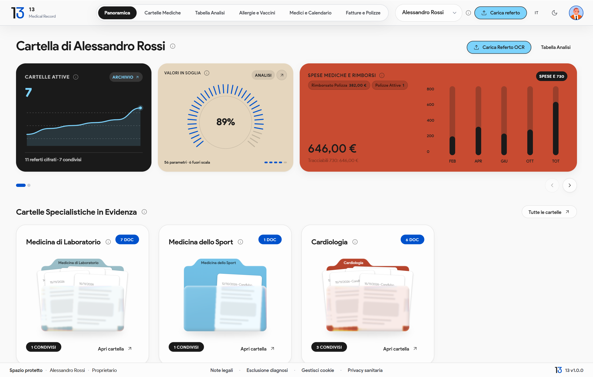
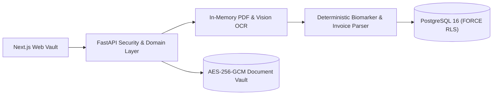
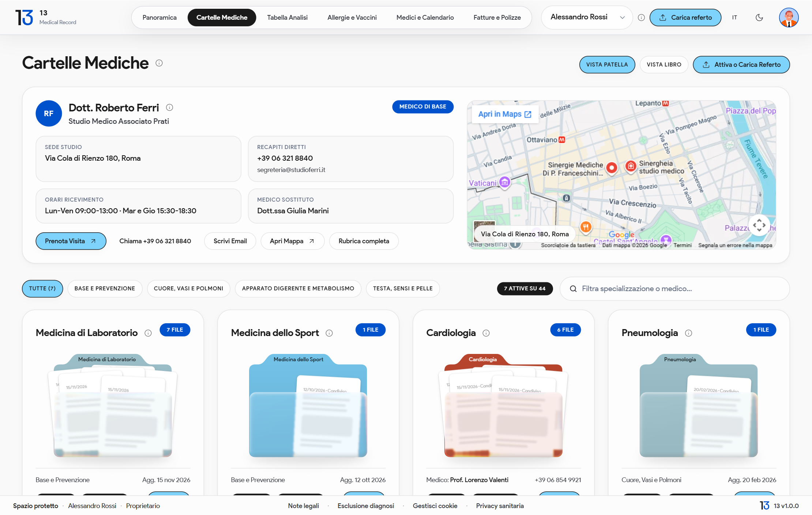
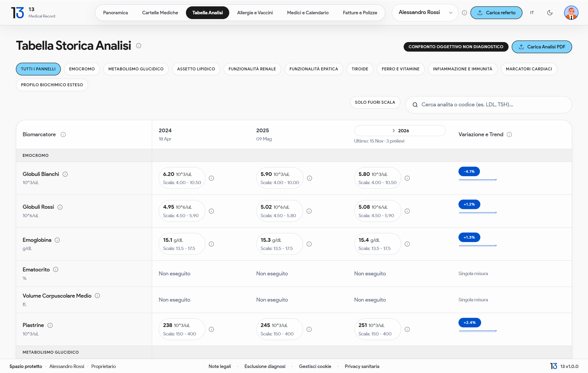
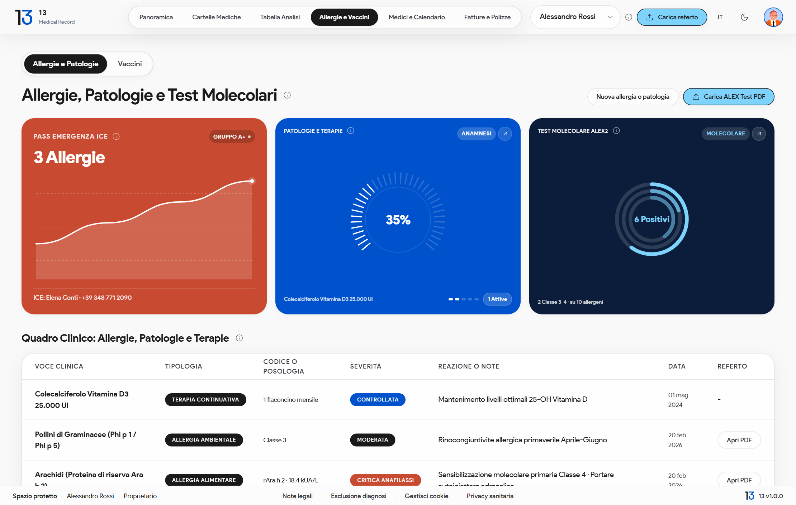
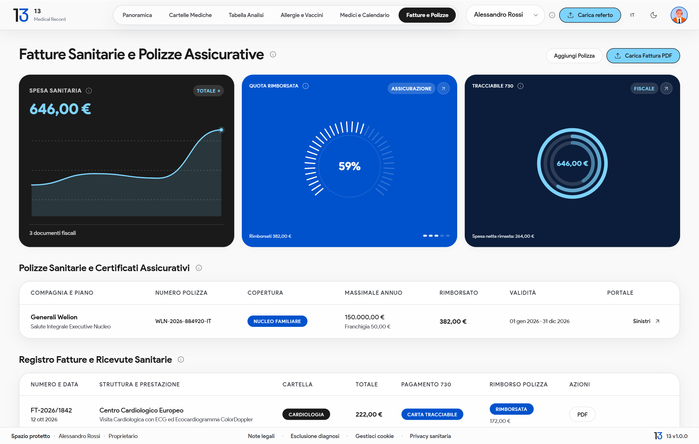

# 13 Medical Record

> **Encrypted personal and family health vault featuring OCR blood-test extraction, multi-year longitudinal biomarker matrices, molecular allergy panels, and deductible expense tracking.**



**Category:** Digital Health & Encrypted Personal Vault SaaS | **Core Stack:** Python, FastAPI, Next.js, TypeScript, PostgreSQL, Vision OCR | **Navigation:** [Back to Portfolio](../README.md)

---

## Project Overview

**13** organizes personal and family medical records (lab reports, prescriptions, specialist visits, vaccinations, molecular allergy tests, and healthcare invoices) inside an encrypted vault. It turns scattered PDF reports into structured, multi-year clinical histories without altering original laboratory reference scales or offering automated medical diagnoses.

- **Main purpose:** Centralize family health documentation with strict cryptographic privacy and objective historical comparison.
- **Primary use case:** Tracking blood biomarkers across years, managing specialist folders and emergency allergy cards, and reconciling deductible medical invoices with insurance reimbursements.
- **Source code policy:** This folder is a public technical showcase. The production source code remains private; all screenshots display synthetic demo data.

---

## Objectives

Personal medical files typically accumulate across email attachments, paper folders, and incompatible hospital portals, making multi-year lab comparison and tax-season receipt tracking tedious.

- **Non-diagnostic fidelity:** Preserve each laboratory's exact unit, analytical method, and printed reference interval, linking every extracted number directly to its source PDF page.
- **Zero-compromise health privacy:** Protect sensitive health data under GDPR Art. 9 and Art. 32 using per-resource authenticated encryption and database-level row isolation.
- **Unified administrative tracking:** Connect clinical visits directly to medical invoices, tax-deductibility checks (Italian Form 730), and insurance policy claims.

---

## Key Features

- **44 Medical Specialty Folders:** Organizes records across a structured clinical catalog with cross-folder relational linking so a single lab report appears in relevant specialist views without file duplication.
- **Longitudinal Blood-Test Matrix:** Aligns biomarkers in a canonical row order across years and expandable months, explicitly avoiding mathematical averaging across separate blood draws.
- **ICE Emergency Pass & Molecular Allergies:** Separates critical emergency data (blood type, severe allergies, emergency contacts) and supports 200+ allergen multiplex IgE panels (`ALEX2` / `ISAC`).
- **Physician Directory & Visit Calendar:** Tracks general practitioners and specialists with integrated studio maps, visit histories, and follow-up schedules.
- **Deductible Expenses & Family IAM:** Computes cent-exact healthcare spending, verifies traceable payment methods for tax deductions, tracks insurance deductibles, and supports revocable family delegations.

---

## Development Approach

**13** separates optical text recognition from clinical data structuring: in-memory OCR engines convert native or scanned PDFs into raw tables, while deterministic parsers normalize biomarker identifiers and monetary totals.

- **Authenticated vault encryption:** Uploaded PDFs and sensitive columns are encrypted at rest with `AES-256-GCM` using `HKDF-SHA256` key derivation and tenant-plus-resource additional authenticated data (`AAD`).
- **Searchable privacy via blind indexes:** Exact lookups on encrypted identifiers rely on keyed `HMAC-SHA256` blind indexes rather than plaintext columns.
- **Tamper-evident audit trail:** Every read, share, and export action is recorded in an append-only hash-chained audit table supporting full GDPR data portability and erasure.

---

## Architecture Overview

A Next.js web application communicates with an async FastAPI backend. Document uploads are processed entirely in RAM by native PDF or local Vision-OCR workers before encrypted persistence in storage and PostgreSQL.



- **Interface Layer:** Next.js 16 workspace with instant family-profile switching, longitudinal lab tables, and interactive specialist maps.
- **Processing Layer:** In-memory PDF text extraction and local open-weight Vision OCR paired with deterministic biomarker and accounting engines.
- **Security & Storage Layer:** PostgreSQL 16 with `FORCE ROW LEVEL SECURITY` across all tables, encrypted `.13vault` blobs, `Argon2id` + `TOTP` authentication, and append-only audit logs.

---

## Screenshots & Demonstrations

*(All screenshots show synthetic demonstration profiles.)*

| Medical Specialty Folders & GP Card | Multi-Year Longitudinal Blood Matrix |
| :--- | :--- |
| <br><sub>Active specialty folders paired with quick access to the primary care physician's contact details, hours, and studio map.</sub> | <br><sub>Multi-year biomarker comparison preserving per-lab reference ranges, trend deltas, and missing-test indicators without averaging.</sub> |

| ICE Emergency Pass & Molecular Allergies | Medical Invoices, 730 Tax & Insurance |
| :--- | :--- |
| <br><sub>Dedicated clinical overview combining critical emergency allergy alerts, active therapies, and molecular IgE test summaries.</sub> | <br><sub>Financial dashboard tracking annual medical spending, traceable 730 tax eligibility, and insurance reimbursement ratios.</sub> |

---

## Code Samples

The generic snippet below demonstrates an append-only `HMAC-SHA256` audit chain pattern, where each audit entry cryptographically commits to the previous entry's digest so unauthorized row edits or deletions are detectable:

```python
import hashlib
import hmac


def compute_audit_digest(
    secret_key: bytes,
    prev_digest: str,
    tenant_id: str,
    action: str,
    resource_id: str,
    timestamp_iso: str,
) -> str:
    """Chain a new audit event to the preceding digest using HMAC-SHA256."""
    canonical_payload = "|".join(
        [prev_digest, tenant_id, action, resource_id, timestamp_iso]
    ).encode("utf-8")
    return hmac.new(secret_key, canonical_payload, hashlib.sha256).hexdigest()
```

---

## Results

- **What was achieved:** An encrypted personal and family medical record platform uniting longitudinal lab matrices, molecular allergy tracking, specialist maps, and healthcare expense accounting.
- **Practical value:** Gives individuals and families immediate, structured access to years of clinical history and tax-deductible receipts without sacrificing data ownership or confidentiality.
