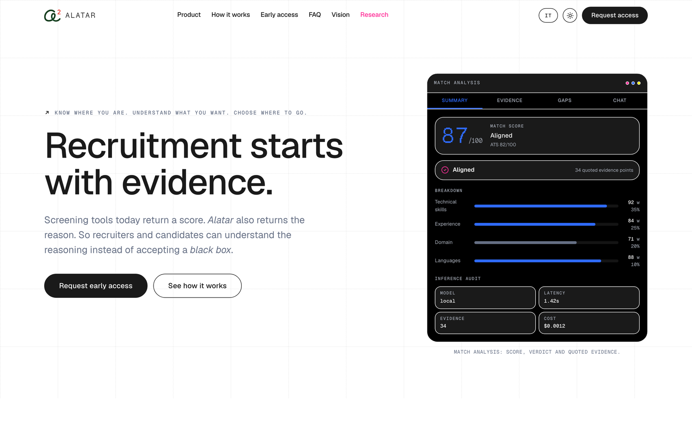
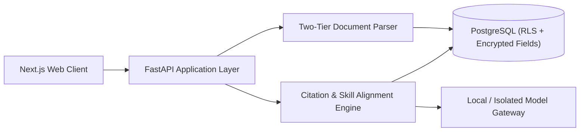
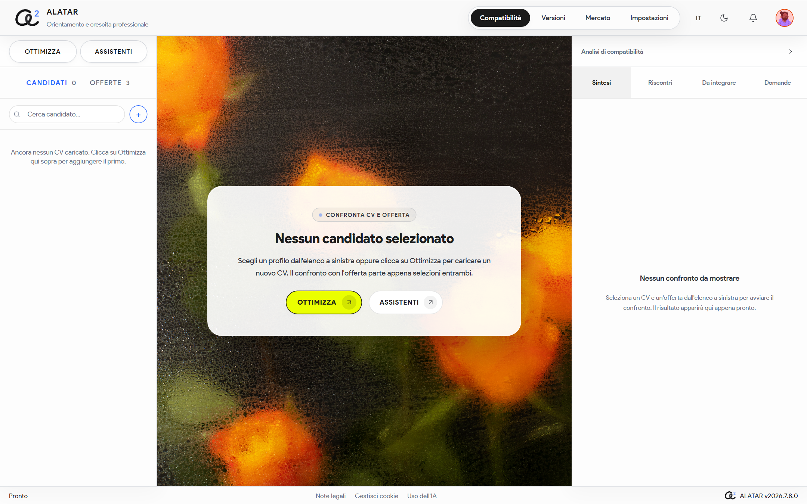
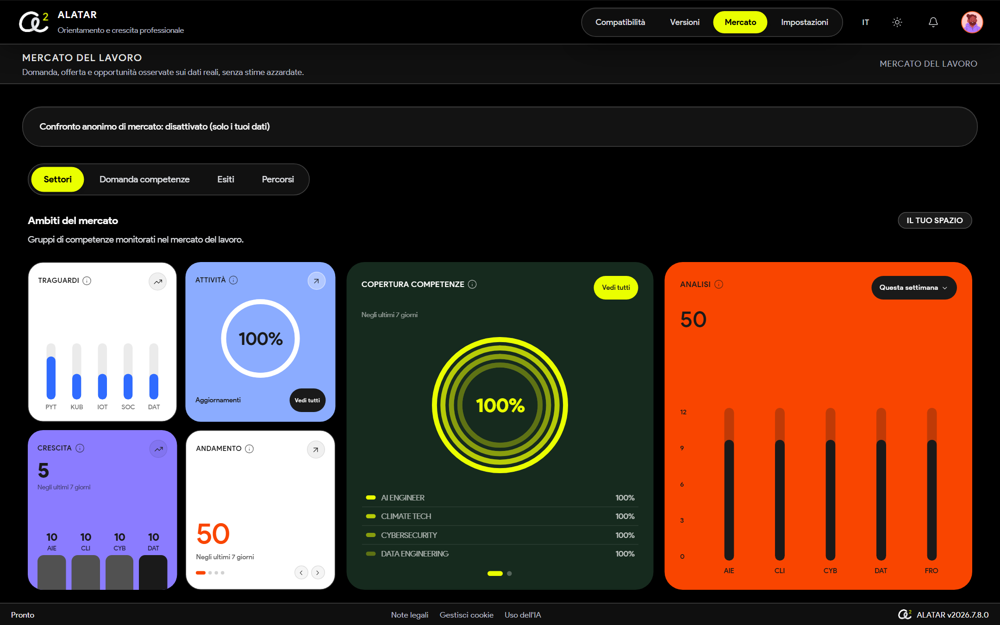
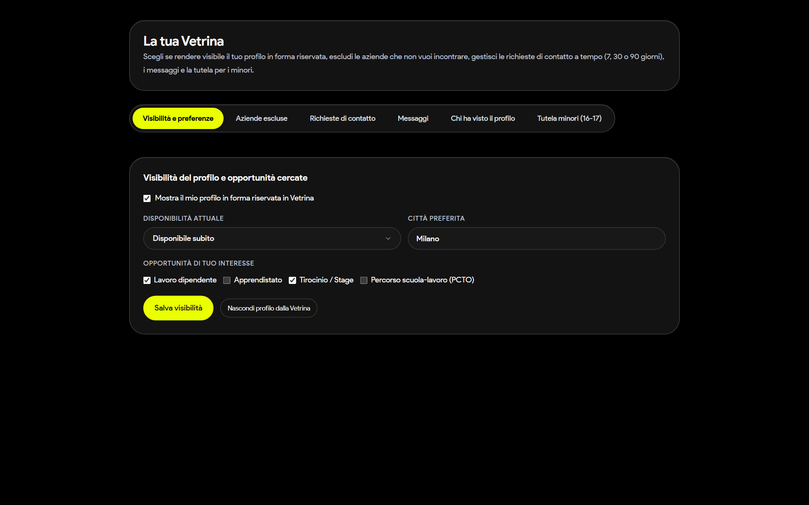
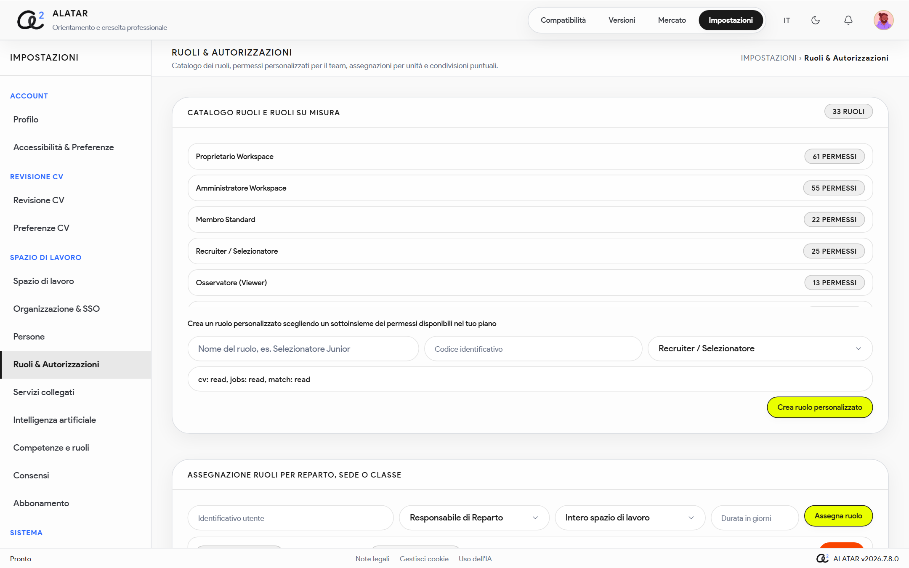

# Alatar

> **Career intelligence platform that aligns candidate CVs with job descriptions and returns scored, evidence-backed match assessments auditable by both recruiters and candidates.**



**Category:** B2B / B2C Career Intelligence SaaS | **Core Stack:** Python, FastAPI, Next.js, TypeScript, PostgreSQL | **Navigation:** [Back to Portfolio](../README.md)

---

## Project Overview

Alatar evaluates how well a candidate profile aligns with a job requirement by pairing structured document parsing with citation-backed matching. Instead of returning an opaque score, every assessment links its conclusions to verifiable excerpts from the CV and job description.

- **Main purpose:** Replace black-box applicant screening with transparent, auditable talent matching.
- **Primary use case:** Candidate CV alignment, recruiter shortlisting with blind-review options, and privacy-safe labor market analysis.
- **Source code policy:** This folder is a public technical showcase. The production source code remains private.

---

## Objectives

Standard screening tools compress a candidate's background into an unexplained number, making decisions hard to verify and prone to hidden bias.

- **Explainable assessments:** Back every score breakdown and identified skill gap with quoted source passages.
- **Factual CV refinement:** Help candidates improve clarity and structure without inventing unverified experience.
- **Governance by design:** Enforce strict workspace access controls, audit logs, and privacy safeguards aligned with GDPR and EU AI Act requirements for HR software.

---

## Key Features

- **Evidence-Backed Match Analysis:** Breaks compatibility down by skill, experience, domain, and language, attaching direct citations and gap notes to each dimension.
- **Grounded CV Versioning:** Assists candidates in tailoring CVs for specific roles while blocking unsupported claims through a fidelity check.
- **Privacy-Controlled Candidate Showcase:** Allows candidates to publish an anonymized profile, exclude specific employers, and grant time-bounded contact access.
- **Observed Market Intelligence:** Aggregates anonymized skill demand and role trends from observed data rather than speculative forecasts.
- **Multi-Workspace Governance:** Provides role-based permissions, department-scoped access, and recruiter blind-mode controls for teams and institutions.

---

## Development Approach

Alatar follows a deterministic-first pipeline: tasks that can be solved reliably with rules, typed schemas, and relational graph queries are handled outside generative models, reserving language models for structured extraction and grounded synthesis.

- **Deterministic document routing:** Native PDF text extraction runs by default, falling back to OCR only when a document lacks a readable text layer.
- **Database-side skill traversal:** Related and transferable skills are resolved inside PostgreSQL via parameterized recursive queries rather than loading graphs into application memory.
- **Provider-agnostic interfaces:** Storage, embeddings, and model inference sit behind narrow protocol contracts so infrastructure adapters can be swapped without touching domain logic.

---

## Architecture Overview

A Next.js web client communicates with an asynchronous FastAPI backend. Document ingestion, skill-graph resolution, and match verification write to a tenant-isolated PostgreSQL database with field-level encryption for sensitive personal records.



- **Client Layer:** Responsive web workspace supporting candidate optimization flows, recruiter comparisons, and organization settings.
- **Application Layer:** FastAPI services managing ingestion, skill-transferability lookup, citation verification, and role-based access control.
- **Data & Security Layer:** PostgreSQL with row-level isolation, encrypted personal fields, and append-only inference audit records.

---

## Screenshots & Demonstrations

| Compatibility Workspace | Observed Labor Market Trends |
| :--- | :--- |
| <br><sub>Main comparison workspace where candidates and recruiters select profiles and job descriptions for side-by-side analysis.</sub> | <br><sub>Market view summarizing observed sector activity and skill coverage without cross-tenant data leakage.</sub> |

| Candidate Privacy & Showcase Controls | Workspace Roles & Access Governance |
| :--- | :--- |
| <br><sub>Granular visibility controls allowing candidates to hide their identity, block specific companies, and set expiration windows.</sub> | <br><sub>Role catalog and custom permission builder for multi-member recruiting and career-service workspaces.</sub> |

---

## Code Samples

The generic example below illustrates how Alatar enforces citation grounding on extracted claims before accepting them into an assessment report, without exposing proprietary scoring logic:

```python
from dataclasses import dataclass


@dataclass(frozen=True, slots=True)
class EvidenceSpan:
    claim: str
    quoted_source: str


def verify_grounded_claims(
    source_text: str, candidates: list[EvidenceSpan]
) -> list[EvidenceSpan]:
    """Accept only claims whose exact supporting quote appears in the source text."""
    normalized_source = " ".join(source_text.lower().split())
    verified: list[EvidenceSpan] = []

    for item in candidates:
        quote = " ".join(item.quoted_source.lower().split())
        if quote and quote in normalized_source:
            verified.append(item)

    return verified
```

---

## Results

- **What was achieved:** A full-stack multi-workspace platform uniting CV parsing, citation-backed job alignment, candidate privacy controls, and bilingual marketing and research surfaces.
- **Practical value:** Gives recruiters an auditable rationale for shortlisting decisions while giving candidates clear, factual feedback on how their profile reads against real requirements.
