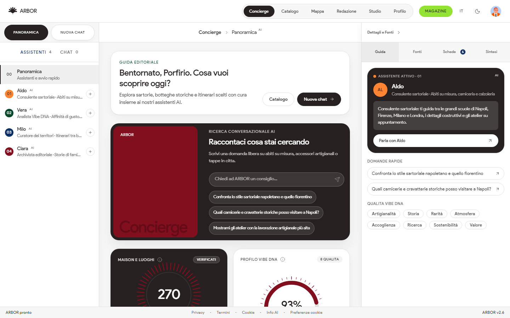
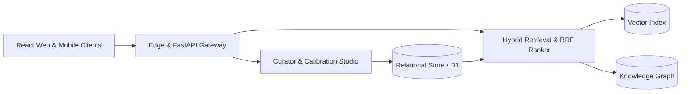
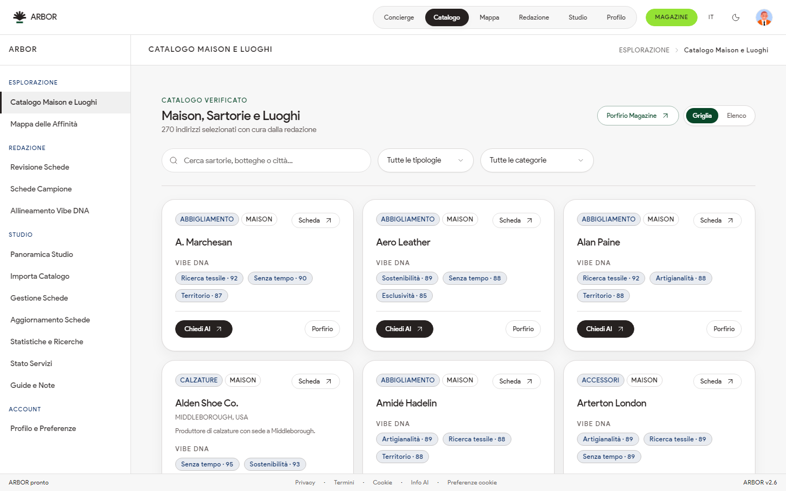
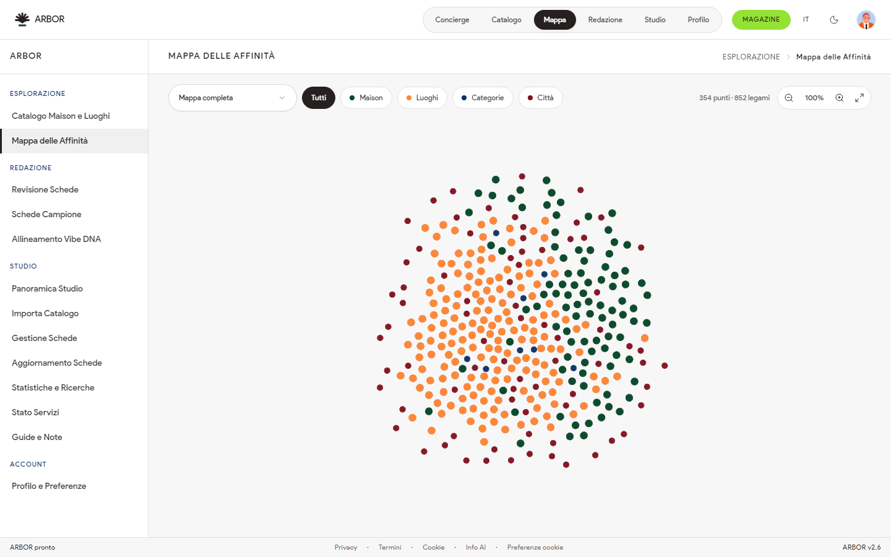
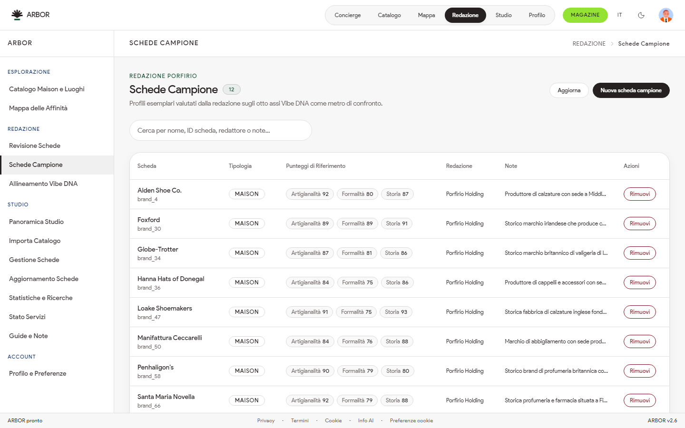

# ARBOR

> **Multi-tenant discovery, curation, and ontological reasoning platform that maps and connects 270 verified luxury ateliers, heritage brands, and cultural venues.**



**Category:** Vertical AI & Knowledge Graph SaaS | **Core Stack:** Python, FastAPI, React, TypeScript, Cloudflare Workers, PostgreSQL, Neo4j, Qdrant | **Live Platform:** [arbor.porfiriomagazine.it](https://arbor.porfiriomagazine.it) | **Navigation:** [Back to Portfolio](../README.md)

---

## Project Overview

ARBOR (*Advanced Reasoning By Ontological Rules*) is an entity intelligence platform built to organize curated real-world businesses and cultural destinations through a structured multi-dimensional ontology. It powers conversational discovery, semantic affinity mapping, and editorial curation over verified records.

- **Main purpose:** Turn editorial domain knowledge into a searchable, relationship-aware discovery engine.
- **Primary use case:** Conversational recommendations, cross-city itinerary building, and structured catalog curation across 270 verified Maisons and venues.
- **Source code policy:** This folder is a public technical showcase. The production source code remains private.

---

## Objectives

Keyword directories struggle to capture qualitative attributes such as craftsmanship, heritage, atmosphere, or stylistic affinity across different cities and product categories.

- **Structured taste representation:** Evaluate entities consistently across defined qualitative dimensions calibrated against editorial reference profiles.
- **Grounded conversational discovery:** Answer open-ended user queries using only verified catalog entities and explicit relationships.
- **Config-driven adaptability:** Keep taxonomies, scoring dimensions, and domain rules declarative so new verticals can be onboarded without rewriting core services.

---

## Key Features

- **Conversational AI Concierge:** Routes natural-language requests to specialized domain assistants that recommend ateliers, brands, and city itineraries with cited catalog cards.
- **Hybrid Search & Reranking:** Combines dense vector similarity, keyword matching, and knowledge-graph traversal through Reciprocal Rank Fusion and staged reranking.
- **Interactive Semantic Affinity Map:** Visualizes 350+ nodes and 850+ relationships across Maisons, venues, categories, and cities for exploratory browsing.
- **Curator Studio & Calibration:** Provides editors with reference benchmark profiles (*Gold Standards*), review queues, and catalog synchronization tools.
- **Edge & Enterprise Deployment:** Pairs low-latency Cloudflare edge delivery for live editorial traffic with durable workflow orchestration for background ingestion.

---

## Development Approach

ARBOR separates editorial truth from generative phrasing: structured entity records and calibrated scores act as the single source of truth, while language models interpret user intent and synthesize grounded explanations.

- **Graceful retrieval degradation:** A multi-stage ranking funnel falls back cleanly to deterministic vector-plus-keyword fusion if an external reranker or model provider is slow or unavailable.
- **Human-in-the-loop calibration:** Automated entity enrichment is anchored to human-scored reference profiles so qualitative ratings do not drift over time.
- **Strict tenant boundaries:** Request-scoped tenant context and role-based permissions isolate editorial workspaces and catalog operations end to end.

---

## Architecture Overview

User requests enter through a React web workspace and edge API gateway, which coordinate intent routing, hybrid retrieval across relational, vector, and graph stores, and grounded response assembly.



- **Interface Layer:** React workspace featuring the conversational concierge, filterable catalog cards, interactive affinity graph, and editorial studio.
- **Retrieval & Reasoning Layer:** Intent router, Reciprocal Rank Fusion combiner, cost-aware reranking pipeline, and grounded response builder.
- **Data Layer:** Synchronized relational store, vector index for semantic similarity, and property graph for brand, venue, and city relationships.

---

## Screenshots & Demonstrations

| Conversational AI Concierge | Verified Maisons & Venues Catalog |
| :--- | :--- |
| <br><sub>Interactive concierge workspace with specialized editorial assistants, suggested prompts, and cited venue cards.</sub> | <br><sub>Filterable directory of 270 verified ateliers and heritage brands displaying multi-dimensional profile tags.</sub> |

| Semantic Affinity Graph | Editorial Calibration Studio |
| :--- | :--- |
| <br><sub>Interactive network map linking Maisons, venues, categories, and cities across 850+ semantic edges.</sub> | <br><sub>Reference benchmark view used by editors to maintain consistent scoring across qualitative attributes.</sub> |

---

## Code Samples

The generic snippet below demonstrates Reciprocal Rank Fusion (RRF), the technique used to merge dense semantic hits and sparse keyword matches into a single ranked list without fragile score normalization:

```python
from collections import defaultdict


def reciprocal_rank_fusion(
    ranked_lists: list[list[str]], k: int = 60, top_n: int = 20
) -> list[tuple[str, float]]:
    """Combine multiple ranked ID lists into a unified consensus ranking."""
    fused_scores: dict[str, float] = defaultdict(float)

    for results in ranked_lists:
        for rank, doc_id in enumerate(results, start=1):
            fused_scores[doc_id] += 1.0 / (k + rank)

    ordered = sorted(fused_scores.items(), key=lambda item: item[1], reverse=True)
    return ordered[:top_n]
```

---

## Results

- **What was achieved:** A live multi-surface discovery and curation platform serving 270 verified international Maisons and venues, integrated directly with [Porfirio Magazine](../porfirio-magazine/README.md).
- **Practical value:** Enables readers and editors to move from static directory lookups to contextual, explainable discovery grounded in verified domain curation.
