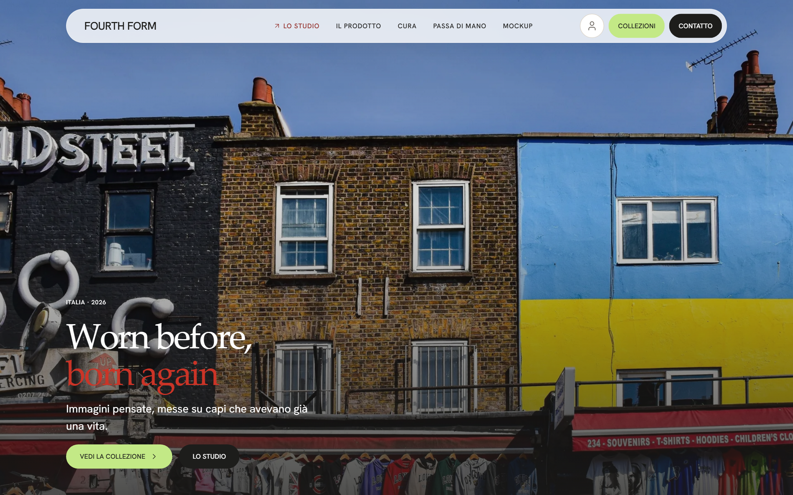
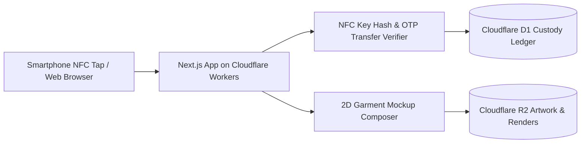
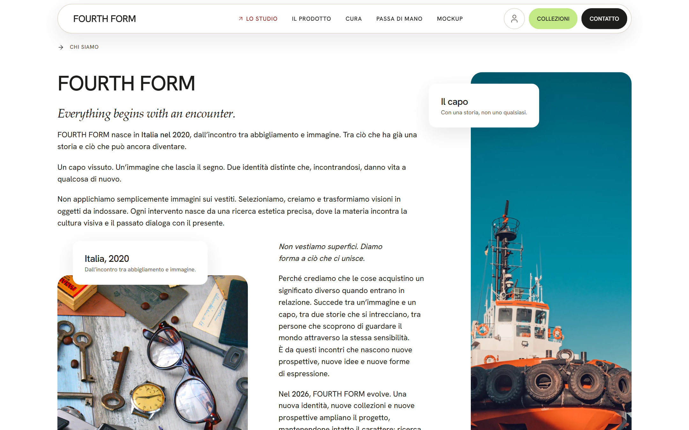
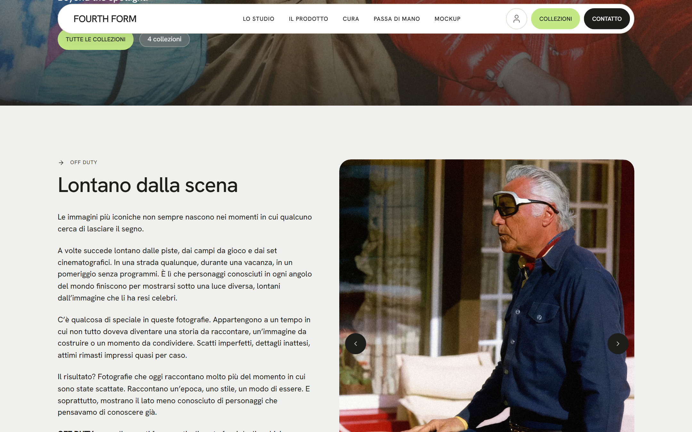
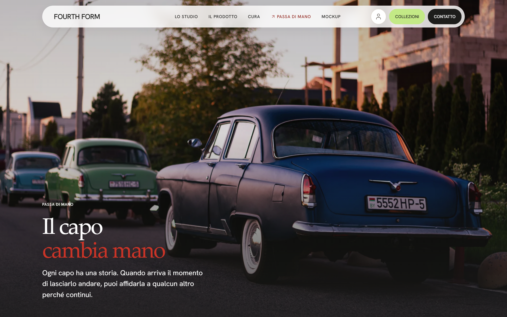
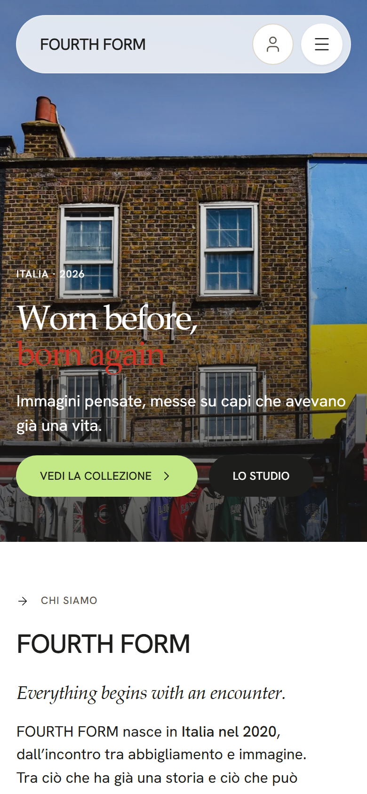

# Fourth Form

> **Editorial web platform and NFC chain-of-custody archive for numbered wearable-art garments, featuring OTP ownership transfers, authenticated garment passports, and an interactive 2D mockup studio.**



**Category:** Connected Product & Wearable Art Web Platform | **Core Stack:** Next.js, React, TypeScript, Cloudflare Workers, D1, R2, CSS Tokens | **Live Platform:** [fourthform.it](https://fourthform.it) | **Navigation:** [Back to Portfolio](../README.md)

---

## Project Overview

Fourth Form is the digital platform for an independent Italian wearable-art label in which original hand-painted canvases become numbered, Italian-sewn garments. Each physical piece carries a sewn-in NFC tag linked to a digital passport, an authenticated ownership ledger (*Passa di mano*), a shared memory archive, and a collaborative 2D garment mockup studio.

- **Main purpose:** Connect physical numbered garments to a verifiable digital provenance and custody history.
- **Primary use case:** Authenticating a garment via NFC tap, transferring custody to a new owner via OTP verification, and composing artwork proposals on technical garment patterns.
- **Source code policy:** This folder is a public technical showcase. The production source code remains private.

---

## Objectives

Limited-edition physical garments lose their provenance, care history, and story as soon as they leave the studio or change hands on the secondary market.

- **Frictionless physical-to-digital link:** Let any smartphone tap the sewn NFC label to view materials, measurements, care instructions, and verified provenance without installing an app.
- **Continuity across owners:** Allow an existing custodian to hand a piece over to its next owner securely while preserving prior signed memories and respecting privacy erasure rights.
- **Open creative collaboration:** Provide an interactive browser-based 2D studio where artists and visitors can test artwork placement on garment silhouettes and submit proposals.

---

## Key Features

- **Authenticated NFC Garment Passports:** Key-hashed NFC URLs unlock each piece's edition number, source canvas, fabric specifications, care guide, and signed custodian timeline.
- **OTP Custody Handover (*Passa di mano*):** Enables verified ownership transfers combining an initiator-generated OTP with a physical NFC tap by the recipient.
- **Custodian Memory Archive & Privacy Controls:** Lets owners sign optional public wardrobe profiles and attach notes to a garment's history, with granular right-to-erasure controls.
- **Interactive 2D Mockup Studio:** Browser canvas tool for positioning artwork over technical garment flats and submitting collaboration proposals directly to the atelier.
- **Owner Backoffice:** Unified administration panel managing collections, numbered pieces, NFC key bindings, PDF certificates, and studio submissions.

---

## Development Approach

Fourth Form combines an editorial, photography-led visual identity with lightweight edge persistence so authenticated NFC taps resolve quickly from any mobile connection.

- **Token-enforced visual consistency:** Palette, fluid typography, spacing, and radii live in a single CSS token sheet verified by automated unit tests to prevent hardcoded style drift.
- **Touch-first mobile legibility:** Mobile galleries implement accessible WAI-ARIA disclosure navigation and smooth contrast dimming on touch-hold so overlaid text stays readable on small screens.
- **Dual local-and-edge runtime:** A clean data-access layer runs against built-in local SQLite during development and Cloudflare D1 + R2 in production without branching business logic.

---

## Architecture Overview

Next.js routes render editorial pages, the interactive 2D studio, and NFC passport views on Cloudflare Workers, backed by D1 relational storage for custody records and R2 object storage for artwork and garment media.



- **Public & NFC Layer:** Editorial storytelling pages, filterable collection explorer, and key-verified NFC garment passports.
- **Custodian & Studio Layer:** Personal wardrobe management, OTP ownership transfer workflows, and the interactive 2D mockup composer.
- **Edge Storage Layer:** Cloudflare D1 storing collections, NFC key hashes, and custody chains alongside R2 storing high-resolution artwork and PDF certificates.

---

## Screenshots & Demonstrations

| Atelier Philosophy & Craft Process | Filterable Collections Explorer |
| :--- | :--- |
| <br><sub>Editorial story presenting the label's origin and connecting original visual research to numbered garments.</sub> | <br><sub>Public collection monograph combining narrative context, garment photography, and custodian records.</sub> |

| NFC Ownership Handover (*Passa di mano*) | Mobile-First Touch Experience |
| :--- | :--- |
| <br><sub>Dedicated handover entry point guiding current and incoming custodians through verified garment transfers.</sub> | <br><sub>Mobile layout optimized for on-the-go NFC taps, touch-friendly galleries, and high-contrast typography.</sub> |

---

## Code Samples

The generic example below illustrates constant-time verification of a hashed NFC tag key so URL tap tokens are never stored in plaintext or exposed to timing side-channels:

```typescript
import { createHash, timingSafeEqual } from "node:crypto";

export function verifyNfcTagKey(providedKey: string, storedSha256Hex: string): boolean {
  const candidateDigest = createHash("sha256").update(providedKey, "utf8").digest();
  const expectedDigest = Buffer.from(storedSha256Hex, "hex");

  if (candidateDigest.length !== expectedDigest.length) {
    return false;
  }
  return timingSafeEqual(candidateDigest, expectedDigest);
}
```

---

## Results

- **What was achieved:** A live connected-garment and editorial web platform uniting public collections, NFC authenticity passports, OTP custody transfers, a 2D mockup studio, and an administrative backoffice.
- **Practical value:** Gives physical limited-edition garments a durable, verifiable digital life across multiple owners without requiring native app downloads or blockchain complexity.
