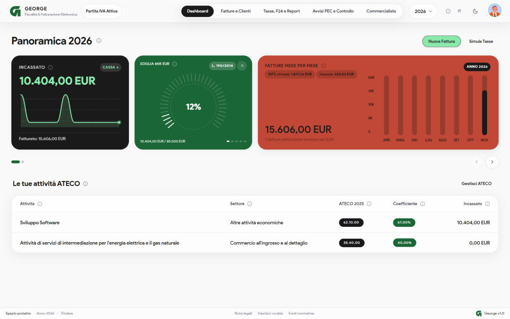
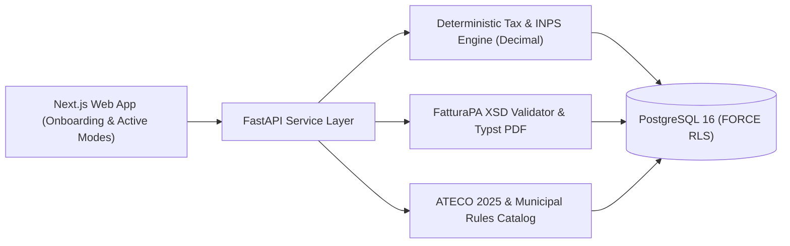
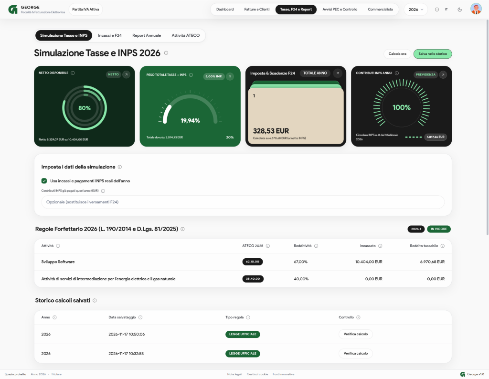

# George

> **Deterministic tax simulation, ATECO 2025 classification, and FatturaPA electronic invoicing platform for Italian sole proprietors (*Regime Forfettario*).**



**Category:** FinTech & Tax Compliance SaaS | **Core Stack:** Python, FastAPI, Next.js, TypeScript, PostgreSQL, Typst | **Navigation:** [Back to Portfolio](../README.md)

---

## Project Overview

George helps Italian freelancers and sole proprietors open, simulate, and manage a *Partita IVA* under the flat-rate tax regime (*Regime Forfettario*). It unifies pre-opening regulatory orientation and daily invoicing operations in a single account with cent-exact calculations.

- **Main purpose:** Make Italian sole-proprietor tax compliance predictable, transparent, and error-free.
- **Primary use case:** Selecting the right ATECO 2025 code before opening a VAT number, issuing validated FatturaPA XML invoices, and tracking real net income after taxes and INPS contributions.
- **Source code policy:** This folder is a public technical showcase. The production source code remains private.

---

## Objectives

Freelancers often face fragmented rules across tax rates, pension funds, municipal permits, and XML e-invoicing schemas, leading to unexpected tax bills or rejected filings.

- **Zero-LLM runtime determinism:** Compute every tax liability, pension contribution, and revenue threshold with exact decimal arithmetic anchored to official statutory rules.
- **End-to-end onboarding to operations:** Support users both before registration (feasibility and net-pay simulation) and after registration (invoicing, F24 tracking, and accountant handoff).
- **Pre-emission compliance checks:** Validate electronic invoices offline against official schemas before submission to the Italian Exchange System (SdI).

---

## Key Features

- **Dual-Mode Workspace:** Seamless toggle between a 4-step pre-opening orientation wizard (covering all 1,290 ISTAT ATECO 2025 codes and 7,833 municipalities) and an active VAT operational dashboard.
- **Multi-Scenario Net Income Simulator:** Compares 5% start-up vs. 15% standard tax rates, 35% INPS reductions, and secondary ATECO activities on real or projected cash receipts.
- **Validated FatturaPA XML Invoicing:** Generates domestic (`TD01`, `TD04`, `TD06`) and cross-border reverse-charge (`TD17`, `TD18`) XML invoices with offline XSD validation and courtesy PDF rendering.
- **PEC Notice & Compliance Assistant:** Parses tax notices and `.eml` certified-mail envelopes into plain Italian and cross-checks amounts against recorded F24 payments.
- **Read-Only Accountant Sharing:** Exports structured PDF dossiers via `Typst` and offers invite-based read-only access for external tax advisors.

---

## Development Approach

Because financial and statutory outputs cannot tolerate probabilistic approximations, George excludes generative models from runtime calculations entirely.

- **Exact monetary math:** All currency figures, profitability coefficients (`40%` to `86%`), stamp duties, and F24 splits run on fixed-precision `Decimal` arithmetic (`ROUND_HALF_UP`).
- **Offline schema verification:** Outgoing and imported XML invoices are checked against official SOGEI XSD definitions using hardened XML parsers (`defusedxml` + `xmlschema`) to prevent malformed files and XML entity attacks.
- **Database-enforced tenant isolation:** PostgreSQL 16 `FORCE ROW LEVEL SECURITY`, `AES-256-GCM` field encryption, `TOTP` 2FA, and `HMAC-SHA256` audit chains protect taxpayer data.

---

## Architecture Overview

A Next.js web application interacts with an async FastAPI backend backed by a deterministic regulatory engine, an XML/PDF document compiler, and a tenant-isolated PostgreSQL database.



- **Interface Layer:** Next.js 16 and React 19 interface supporting bilingual Light/Dark themes and instant mode switching.
- **Domain Layer:** Statutory tax calculator, ATECO-to-INPS regulatory graph, and FatturaPA XML/Typst document pipeline.
- **Data & Security Layer:** PostgreSQL 16 with row-level security across all tenant tables, Redis background queues, and encrypted sensitive records.

---

## Screenshots & Demonstrations

| Active VAT Cash & Threshold Dashboard | Pre-Opening ATECO & Municipal Wizard |
| :--- | :--- |
| <br><sub>Operational dashboard tracking real collected cash, the 85,000 EUR statutory cap, monthly invoicing, and active ATECO coefficients.</sub> | <br><sub>Guided 4-step classification workspace mapping an activity across 1,290 ATECO 2025 codes and 7,833 Italian municipalities.</sub> |

| FatturaPA Electronic Invoicing Archive | Tax, INPS & Net-Pay Simulator |
| :--- | :--- |
| <br><sub>Electronic invoice management with virtual stamp-duty tracking and offline XSD schema verification status badges.</sub> | <br><sub>Cent-exact simulation of net take-home pay, substitute tax, and INPS contributions based on real cash receipts.</sub> |

---

## Code Samples

The standalone example below illustrates exact `Decimal` computation of taxable base and substitute tax using official profitability coefficients without floating-point rounding drift:

```python
from decimal import Decimal, ROUND_HALF_UP

TWO_PLACES = Decimal("0.01")


def compute_flat_tax_summary(
    collected_revenue: Decimal,
    profitability_pct: Decimal,
    deductible_contributions: Decimal,
    tax_rate: Decimal = Decimal("0.05"),
) -> dict[str, Decimal]:
    """Compute statutory taxable income and substitute tax to the exact cent."""
    gross_taxable = (collected_revenue * (profitability_pct / Decimal("100"))).quantize(
        TWO_PLACES, rounding=ROUND_HALF_UP
    )
    net_taxable = max(Decimal("0.00"), gross_taxable - deductible_contributions)
    substitute_tax = (net_taxable * tax_rate).quantize(TWO_PLACES, rounding=ROUND_HALF_UP)

    return {
        "gross_taxable": gross_taxable,
        "net_taxable": net_taxable,
        "substitute_tax": substitute_tax,
    }
```

---

## Results

- **What was achieved:** A complete fiscal and e-invoicing SaaS covering the entire lifecycle of an Italian flat-rate sole proprietorship, from pre-opening simulation to XSD-verified XML invoicing.
- **Practical value:** Gives freelancers real-time visibility into net disposable income and statutory thresholds while streamlining collaboration with their accountant.
