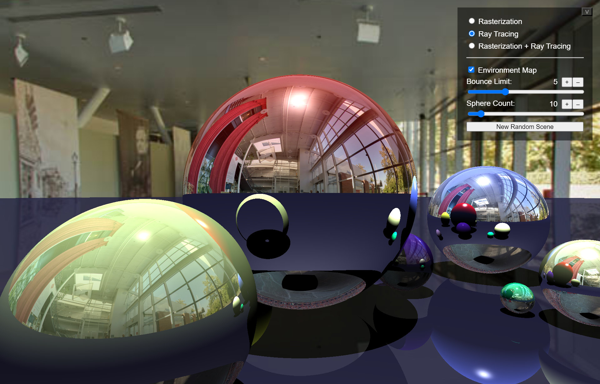
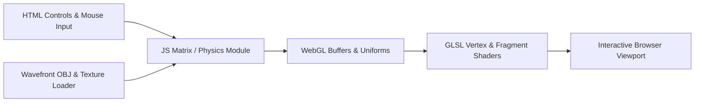
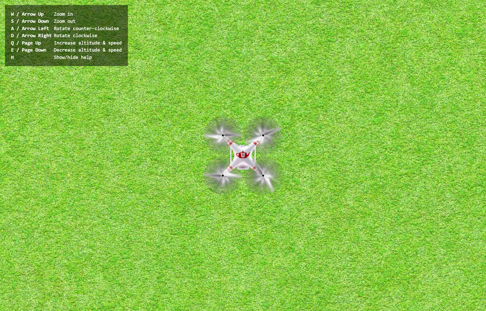
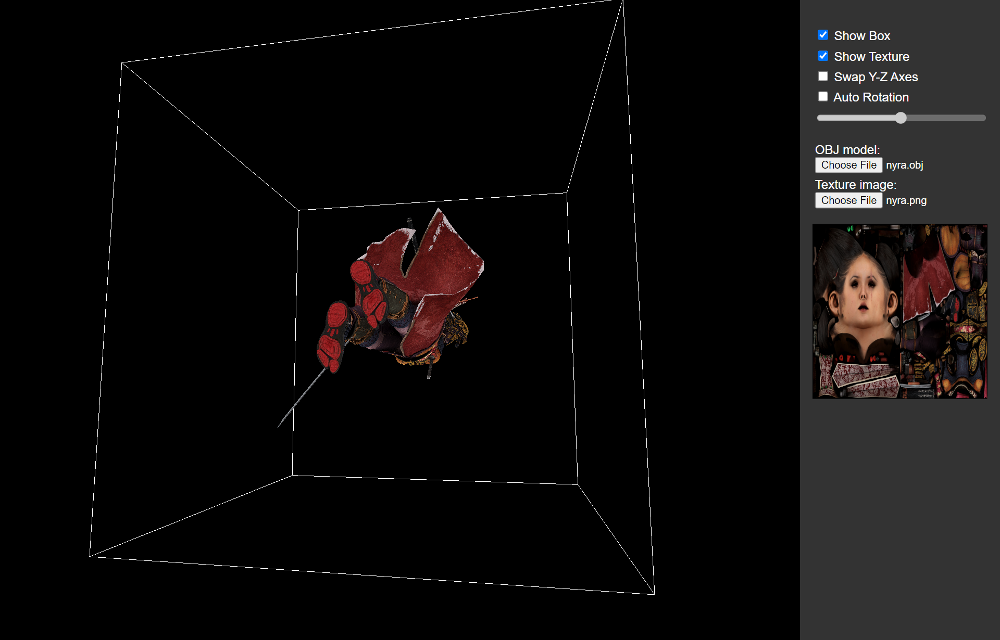
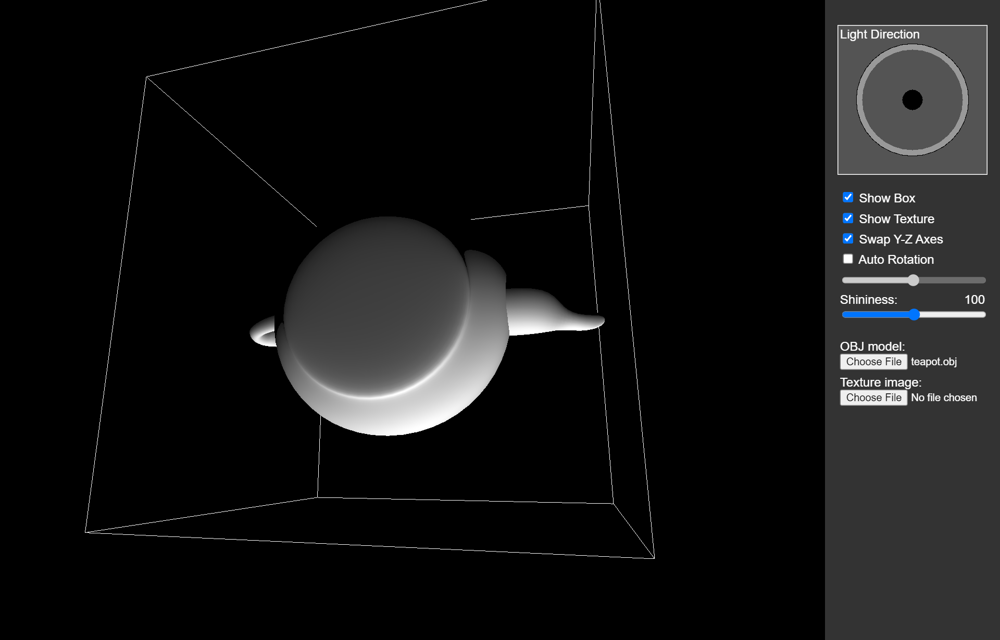
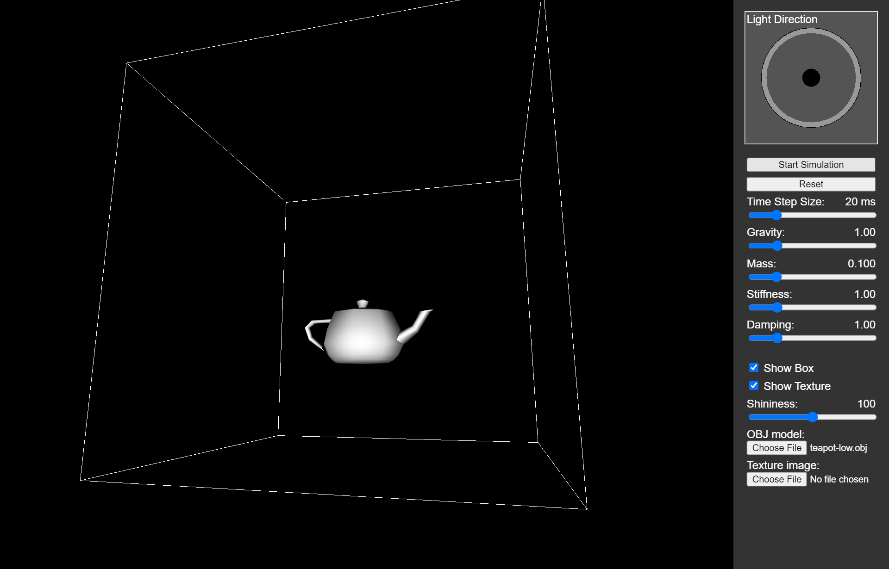

# Interactive Graphics Projects

> **Six self-contained, browser-based computer graphics assignments implementing core 2D/3D rendering, GLSL shading, GPU ray tracing, and mass-spring physics from scratch.**



**Category:** Computer Graphics & Physical Simulation (Academic) | **Core Stack:** JavaScript (ES6), WebGL, GLSL Shaders, HTML5 Canvas | **Public Repository:** [github.com/Ed0C97/marr-interactive-graphics-projects](https://github.com/Ed0C97/marr-interactive-graphics-projects) | **Navigation:** [Back to Portfolio](../README.md)

---

## Project Overview

This project collects six standalone interactive graphics implementations completed for the *Interactive Graphics* course in the MSc in Robotics and Artificial Intelligence at Sapienza University of Rome (adapted from the University of Utah CS4600 curriculum). Every assignment runs natively in the browser with zero external graphics engines or build tools.

- **Main purpose:** Implement foundational rasterization, shading, ray-tracing, and physics algorithms directly on RGBA buffers, matrices, and GPU shaders.
- **Primary use case:** Interactive browser demonstrations progressing from 2D image compositing to real-time 3D WebGL rendering and physically based deformable meshes.
- **Source code availability:** Full source code is publicly available at [Ed0C97/marr-interactive-graphics-projects](https://github.com/Ed0C97/marr-interactive-graphics-projects).

---

## Objectives

High-level 3D engines hide matrix memory layouts, vertex buffer management, shader lighting equations, and numerical integration steps behind scene-graph abstractions.

- **First-principles rendering:** Build transformation pipelines, perspective projection matrices, and WebGL buffer uploads manually in column-major order.
- **Real-time GPU lighting and optics:** Implement both rasterized Blinn-Phong surface shading and recursive fragment-shader ray tracing with shadows and environment reflections.
- **Stable physical animation:** Simulate deformable 3D meshes under spring, gravity, and damping forces with collision resolution.

---

## Key Features

- **Alpha Compositing (Project 1):** Pixel-level `ImageData` RGBA blending with opacity weighting and boundary clipping across layered foreground and background rasters.
- **2D Affine Transformations (Project 2):** Explicit 3x3 column-major scale, rotation, and translation matrix builders (`GetTransform`, `ApplyTransform`) driving an interactive UAV scene.
- **Triangular Mesh & Texture Pipeline (Project 3):** WebGL `MeshDrawer` managing vertex and UV attribute buffers, model-view-projection matrices, Wavefront `.obj` loading, and linear-filtered texture mapping.
- **Per-Fragment Blinn-Phong Shading (Project 4):** Extends the WebGL mesh pipeline with vertex normal transformation, adjustable directional lighting, shininess controls, and diffuse texture modulation.
- **GPU Fragment-Shader Ray Tracing (Project 5):** Real-time GLSL ray-sphere intersection, hard shadow rays, environment cube-map lookups, and multi-bounce specular reflections.
- **Mass-Spring Deformable Physics (Project 6):** Semi-implicit Euler integrator accumulating Hooke spring forces, gravity, and velocity damping with restitution-based bounding-box collisions.

---

## Development Approach

Each assignment isolates the mathematical and GPU core inside a dedicated JavaScript/GLSL module wired to an interactive HTML control harness, making every algorithmic choice immediately testable visually.

- **Zero-dependency execution:** Opening any project's `.html` file in a modern browser runs the full WebGL or Canvas pipeline without bundlers or third-party math libraries.
- **Explicit GPU state management:** Shader compilation, attribute locations, uniform updates, and depth testing are managed directly against the WebGL API.
- **Semi-implicit numerical stability:** Updating particle velocities before positions in the mass-spring solver preserves stability across interactive stiffness and timestep adjustments.

---

## Architecture Overview

Every project runs entirely client-side inside the browser: an HTML host supplies interactive sliders and viewport events, a JavaScript module builds transformation matrices or physics states, and WebGL vertex/fragment shaders execute on the GPU.



- **Host & Asset Layer:** Self-contained HTML interfaces and a Wavefront `.obj` parser producing flat vertex, UV, and normal arrays.
- **CPU Math & Simulation Layer:** Column-major matrix algebra (`3x3` and `4x4`) and semi-implicit Euler particle-spring integration.
- **GPU Rendering Layer:** Custom GLSL vertex and fragment shaders performing perspective projection, Blinn-Phong illumination, and recursive ray tracing.

---

## Screenshots & Demonstrations

| 2D Composed Affine Transformations | WebGL Textured Triangular Mesh |
| :--- | :--- |
| <br><sub>Interactive UAV scene driven by composed 3x3 scale, rotation, and translation matrices across body and spinning rotors.</sub> | <br><sub>Wavefront OBJ character rendered via custom WebGL vertex/UV buffers, model-view-projection math, and texture mapping.</sub> |

| Per-Fragment Blinn-Phong Shading | Real-Time GLSL Ray Tracing |
| :--- | :--- |
| <br><sub>Utah teapot illuminated in real time with per-fragment normal interpolation, directional light control, and specular highlights.</sub> | <br><sub>Fragment-shader ray tracer rendering 10 spheres with hard shadows, 5-bounce specular reflections, and an environment cube map.</sub> |

| Deformable Mass-Spring Simulation |
| :--- |
| <br><sub>Deformable mesh simulated with Hooke spring forces, gravity, damping, semi-implicit Euler steps, and floor collision restitution.</sub> |

---

## Code Samples

Illustrative GLSL snippet showing quadratic ray-sphere intersection used inside a real-time fragment-shader ray tracer (full source available in the [public repository](https://github.com/Ed0C97/marr-interactive-graphics-projects)):

```glsl
bool intersectSphere(vec3 rayOrigin, vec3 rayDir, vec3 center, float radius, out float tHit) {
    vec3 oc = rayOrigin - center;
    float b = dot(oc, rayDir);
    float c = dot(oc, oc) - radius * radius;
    float discriminant = b * b - c;

    if (discriminant < 0.0) return false;

    float root = sqrt(discriminant);
    float t0 = -b - root;
    float t1 = -b + root;
    tHit = (t0 > 1e-4) ? t0 : t1;
    return tHit > 1e-4;
}
```

---

## Results

- **What was achieved:** Six working, dependency-free browser graphics and physics implementations spanning 2D compositing, 3D textured rasterization, per-fragment shading, GPU ray tracing, and deformable-body simulation.
- **Practical value:** Demonstrates solid command of linear algebra, real-time GPU shader programming, and numerical physics integration built from scratch. Full source: [Ed0C97/marr-interactive-graphics-projects](https://github.com/Ed0C97/marr-interactive-graphics-projects).
