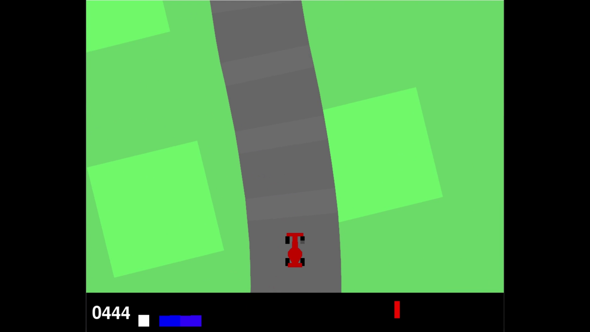
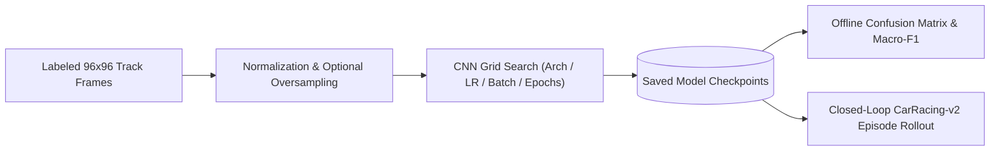
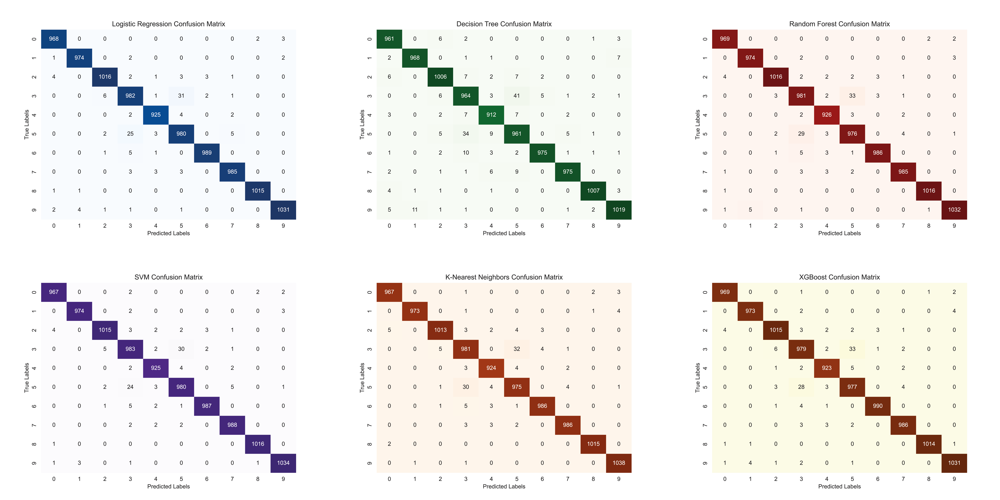
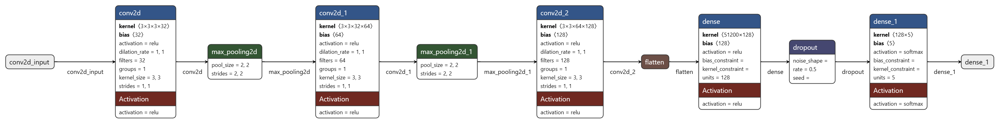
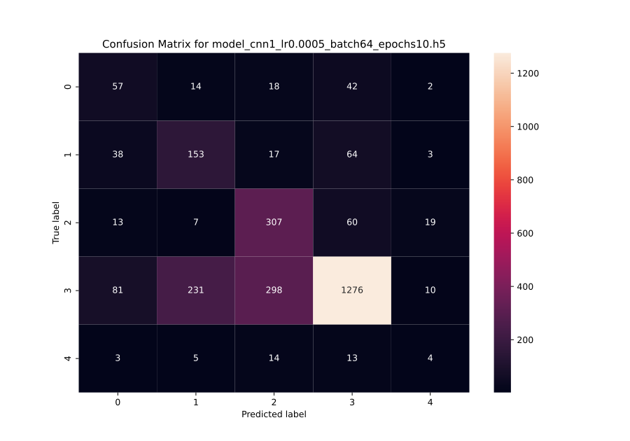

# Machine Learning Projects

> **Two graduate machine-learning studies benchmarking six supervised classifiers against runtime cost and training Convolutional Neural Networks for closed-loop autonomous driving.**



**Category:** Machine Learning & Autonomous Control (Academic) | **Core Stack:** Python, scikit-learn, XGBoost, TensorFlow / Keras, Gymnasium (`CarRacing-v2`), NumPy | **Public Repository:** [github.com/Ed0C97/marr-ml-projects](https://github.com/Ed0C97/marr-ml-projects) | **Navigation:** [Back to Portfolio](../README.md)

---

## Project Overview

This repository showcase presents two coursework projects completed for the *Machine Learning* course in the MSc in Robotics and Artificial Intelligence at Sapienza University of Rome. The first project benchmarks six supervised learning algorithms across dimensionality and compute cost; the second trains and evaluates Convolutional Neural Network (CNN) driving policies inside the Gymnasium `CarRacing-v2` simulation environment.

- **Main purpose:** Evaluate classical and deep-learning models not only by offline test accuracy, but also by computational efficiency and closed-loop control performance.
- **Primary use case:** Multi-class high-dimensional tabular classification (Project 1) and vision-based discrete action selection for simulated track driving (Project 2).
- **Source code availability:** Full code, reports, and simulation artifacts are publicly available at [Ed0C97/marr-ml-projects](https://github.com/Ed0C97/marr-ml-projects).

---

## Objectives

Evaluating machine-learning models solely on held-out accuracy obscures severe training-time penalties on wide feature spaces and fails to reveal compounding control errors in sequential decision tasks.

- **Accuracy-versus-compute trade-offs:** Profile wall-clock runtime and system resource consumption alongside classification metrics across 100-feature and 1,000-feature 10-class datasets.
- **Imbalanced visual policy learning:** Address severe action-class imbalance (straight driving vs. sharp cornering and braking) when learning from recorded RGB track frames.
- **Dual offline and closed-loop validation:** Compare offline macro-F1 and confusion matrices directly against cumulative reward achieved in live `CarRacing-v2` rollouts.

---

## Key Features

- **Six-Classifier Benchmark (Homework 1):** Trains and tunes Logistic Regression, Decision Tree, Random Forest, SVM, KNN, and XGBoost with `StandardScaler`, `GridSearchCV`, and 5-fold cross-validation comparisons.
- **Runtime & Resource Profiling:** Captures execution time and memory/CPU metrics via `psutil` alongside Accuracy, Precision, Recall, F1, and ROC-AUC.
- **Dual CNN Architectures (Homework 2):** Compares a stacked `3x3` Conv/MaxPool network with dropout against a `5x5` Batch-Normalized architecture on `96x96` RGB frames.
- **Controlled Minority Oversampling:** Evaluates balanced versus unbalanced training regimes under a clean resampling toggle to mitigate dominant straight-line class bias.
- **Closed-Loop Gymnasium Rollouts:** Loads hyperparameter-indexed model checkpoints into `CarRacing-v2` to measure real driving stability and total episode reward.

---

## Development Approach

Both studies emphasize systematic experimental grids and reproducible evaluation pipelines, separating data preparation, hyperparameter sweeps, offline diagnostics, and simulation rollouts.

- **Dimensionality sensitivity analysis:** Running identical model families across 10x feature growth (`100` vs. `1,000` features) exposes how distance-based and kernel methods scale compared to regularized linear and tree-ensemble learners.
- **Hyperparameter-keyed checkpointing:** Every combination of architecture, learning rate, batch size, and epoch count is persisted deterministically so offline metrics and in-simulation episode scores map 1:1.
- **Offline vs. online gap analysis:** Pairing per-class confusion matrices with closed-loop track videos highlights why rare steering/braking recall matters more than raw frame accuracy in imitation learning.

---

## Architecture Overview

Homework 1 runs a standardized preprocessing, cross-validated tuning, and compute-profiling loop over tabular datasets. Homework 2 pairs an image-resampling and CNN grid-search trainer with both an offline test evaluator and a closed-loop `CarRacing-v2` policy runner.



- **Tabular Benchmark Pipeline:** Feature standardization, `GridSearchCV` hyperparameter sweeps, 5-fold CV toggling, and `psutil` compute telemetry.
- **CNN Training Pipeline:** Folder-structured RGB ingestion, minority-class resampling, and multi-architecture Keras training sweeps.
- **Closed-Loop Evaluation Layer:** Gymnasium simulation harness mapping live `96x96` RGB observations to discrete steering, gas, and brake commands.

---

## Screenshots & Demonstrations

| Six-Classifier 10-Class Confusion Matrices | CNN Driving Policy Architecture |
| :--- | :--- |
| <br><sub>Side-by-side 10-class confusion matrices comparing Logistic Regression, Decision Tree, Random Forest, SVM, KNN, and XGBoost.</sub> | <br><sub>Convolutional architecture mapping 96x96 RGB observations through stacked Conv2D, MaxPooling2D, Dense, and Dropout layers to 5 driving actions.</sub> |

| Action-Class Offline Evaluation | Closed-Loop `CarRacing-v2` Rollout |
| :--- | :--- |
| <br><sub>Held-out confusion matrix across the 5 discrete driving actions illustrating class distribution between dominant and minority maneuvers.</sub> | <br><sub>Live closed-loop evaluation frame of the trained CNN controller tracking curves autonomously in Gymnasium CarRacing-v2.</sub> |

---

## Code Samples

Illustrative closed-loop evaluation loop running a trained vision policy inside a Gymnasium environment to record cumulative episode reward (full code available in the [public repository](https://github.com/Ed0C97/marr-ml-projects)):

```python
import gymnasium as gym
import numpy as np


def evaluate_driving_policy(model, episodes: int = 5, seed: int = 42) -> list[float]:
    """Run a trained frame-to-action classifier in closed loop on CarRacing-v2."""
    env = gym.make("CarRacing-v2", continuous=False)
    rewards: list[float] = []

    for ep in range(episodes):
        obs, _ = env.reset(seed=seed + ep)
        done, total_reward = False, 0.0
        while not done:
            frame = np.expand_dims(obs.astype("float32") / 255.0, axis=0)
            action = int(np.argmax(model.predict(frame, verbose=0)[0]))
            obs, reward, terminated, truncated, _ = env.step(action)
            total_reward += float(reward)
            done = terminated or truncated
        rewards.append(total_reward)

    env.close()
    return rewards
```

---

## Results

- **What was achieved:** Complete experimental benchmarks, written technical reports, trained CNN checkpoints, and recorded autonomous driving rollouts across both graduate assignments.
- **Practical value:** Demonstrates end-to-end empirical ML rigor, from runtime-aware classical model selection to handling class imbalance and distribution shift in closed-loop visual control. Full source: [Ed0C97/marr-ml-projects](https://github.com/Ed0C97/marr-ml-projects).
