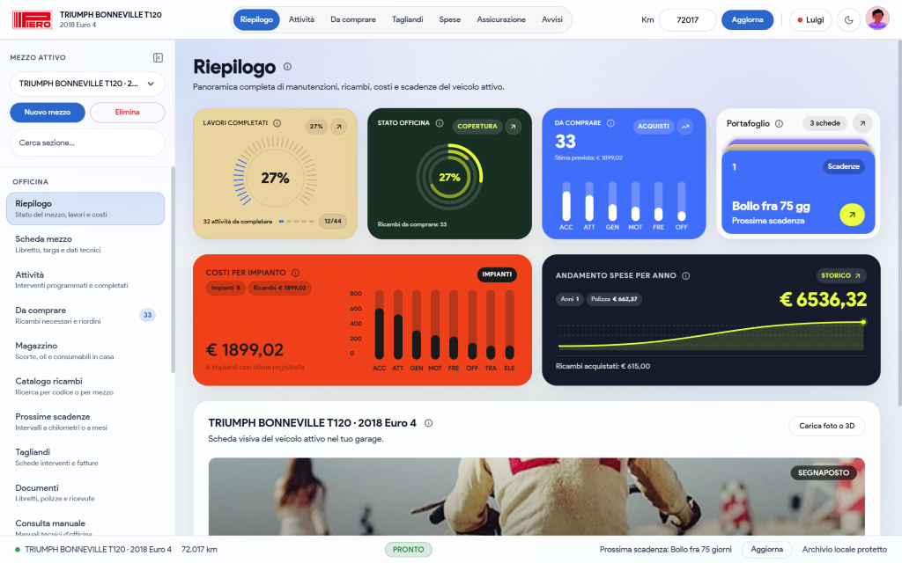
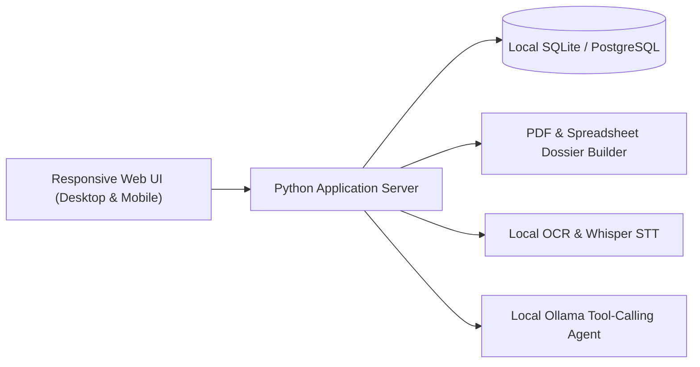
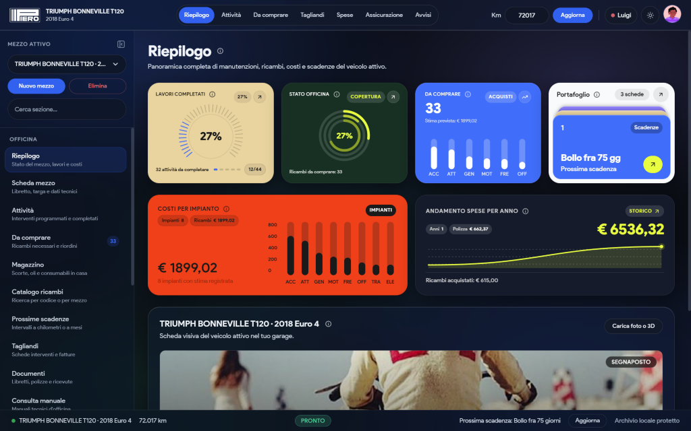
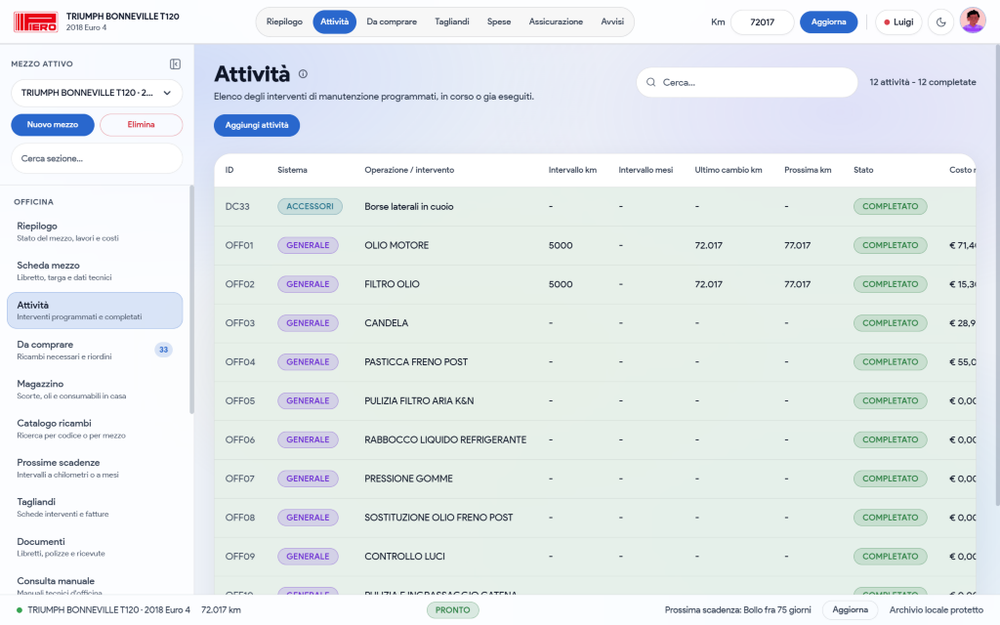
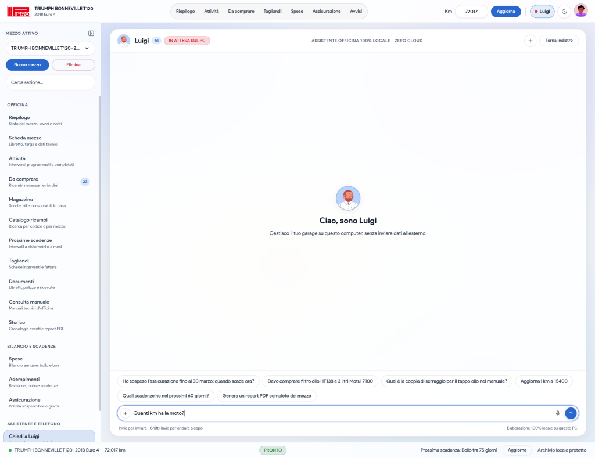

# Piero

> **Local-first and web-deployable workshop management software for motorcycles and multi-vehicle garages, combining maintenance tracking, spare-parts inventory, local OCR import, and an offline AI assistant.**



**Category:** Local-First Desktop & Web Application | **Core Stack:** Python, SQLite / PostgreSQL, Vanilla JS & CSS Design System, Local Ollama, Whisper, Vision OCR | **Navigation:** [Back to Portfolio](../README.md)

---

## Project Overview

Piero is a private garage and workshop management application built to track vehicle maintenance schedules, service history (*Tagliandi*), spare-parts stock (*Magazzino*), recurring deadlines, suspendable insurance policies, and ownership costs without sending personal vehicle records to external clouds.

- **Main purpose:** Centralize multi-vehicle maintenance, inventory, and documents in a fast, local-first workspace.
- **Primary use case:** Managing DIY or shop maintenance intervals, importing vehicle registration and invoice PDFs via local OCR, and querying workshop manuals offline.
- **Source code policy:** This folder is a public technical showcase. The production source code remains private.

---

## Objectives

Enthusiasts and small garages managing multiple vehicles usually split records across spreadsheets, paper invoices, and PDF service manuals, leading to missed service intervals or duplicate part orders.

- **Complete local privacy:** Run storage, document OCR, voice transcription, and AI tool-calling entirely on the user's machine.
- **Coupled inventory and service logs:** Automatically deduct or restore spare parts and consumables when service jobs are recorded or edited.
- **Real-world ownership math:** Accurately handle Italian vehicle deadlines, including suspendable motorcycle insurance policies that shift renewal dates forward.

---

## Key Features

- **Multi-Vehicle Maintenance Catalogue:** Tracks scheduled and completed jobs per subsystem with kilometer and month intervals, inline batch editing, and cost breakdowns.
- **Inventory & Shopping Lists:** Monitors garage stock levels, reorder thresholds, and deduplicated parts-to-buy lists alongside optional local parts-catalog lookups.
- **Confidence-Gated OCR Import:** Extracts structured fields from registration certificates and workshop invoices locally, routing low-confidence fields to human review before saving.
- **Offline Assistant (*Luigi*) & Voice Input:** Connects to local open-weight models via Ollama with read-only lookups and explicit human-confirmation cards for any write action, plus offline speech-to-text.
- **Multi-Audience Dossier Export:** Generates live-formula spreadsheets (`.xlsx` / `.ods`) and tailored PDF reports for the owner, mechanic, or prospective buyer (with sensitive fields redacted).

---

## Development Approach

Piero is designed around local-first resilience and fail-safe data capture: core garage workflows run with zero internet connectivity, and automated assistants can never mutate records silently.

- **Human-in-the-loop mutations:** Read queries execute immediately, whereas any assistant-proposed update (such as logging mileage or adding an expense) renders an explicit *Apply / Ignore* confirmation card.
- **Confidence-thresholded OCR:** Document fields extracted below a strict confidence score are flagged for manual verification rather than overwriting clean vehicle metadata.
- **Hardened local gateway:** Strict `Origin`/`Host` validation, WebAuthn Passkey support, and optional field-level encryption protect the local web server against cross-site and SSRF abuse.

---

## Architecture Overview

A lightweight web interface communicates with a Python application server backed by SQLite (or PostgreSQL), an offline document-export builder, and optional local inference processes for OCR, speech-to-text, and assistant tool-calling.



- **Interface Layer:** Custom CSS token-based workspace supporting Light and Dark themes, Bento telemetry cards, inline editable tables, and a mobile chat layout.
- **Application Layer:** Maintenance scheduler, inventory ledger, suspendable-insurance date calculator, and multi-format report generator.
- **Local AI Layer:** Optional in-memory voice transcription, local Vision OCR, and confirm-before-write workshop tools.

---

## Screenshots & Demonstrations

| Dark Mode & Bento Telemetry | Subsystem Maintenance Schedule |
| :--- | :--- |
| <br><sub>Dark-theme overview displaying job completion rings, system cost distribution, annual expense trends, and upcoming tax/inspection deadlines.</sub> | <br><sub>Filterable per-vehicle maintenance table tracking kilometer intervals, last service mileage, next due thresholds, and part costs.</sub> |

| Offline Workshop Assistant (Desktop) | Edge-to-Edge Mobile Assistant |
| :--- | :--- |
| <br><sub>Full-stage local assistant workspace with voice input, manual lookup prompts, and zero external cloud calls.</sub> | <br><sub>Focused mobile interface for quick mileage updates, deadline checks, and parts queries from the garage floor.</sub> |

---

## Code Samples

The generic example below illustrates confidence-gated OCR routing, ensuring only high-confidence extracted fields auto-populate a form while uncertain reads are queued for user review:

```python
from dataclasses import dataclass


@dataclass(frozen=True)
class ExtractedField:
    name: str
    value: str
    confidence: float


def partition_ocr_fields(
    fields: list[ExtractedField], threshold: float = 0.88
) -> tuple[dict[str, str], list[ExtractedField]]:
    """Split OCR output into auto-accepted values and human-review items."""
    accepted: dict[str, str] = {}
    needs_review: list[ExtractedField] = []

    for field in fields:
        if field.confidence >= threshold and field.value.strip():
            accepted[field.name] = field.value.strip()
        else:
            needs_review.append(field)

    return accepted, needs_review
```

---

## Results

- **What was achieved:** A self-contained workshop platform uniting multi-vehicle service tracking, spare-parts inventory, suspendable insurance math, local OCR, offline voice/AI assistance, and buyer-ready PDF exports.
- **Practical value:** Keeps complete mechanical and financial history organized on the owner's hardware with zero subscription lock-in or cloud data exposure.
