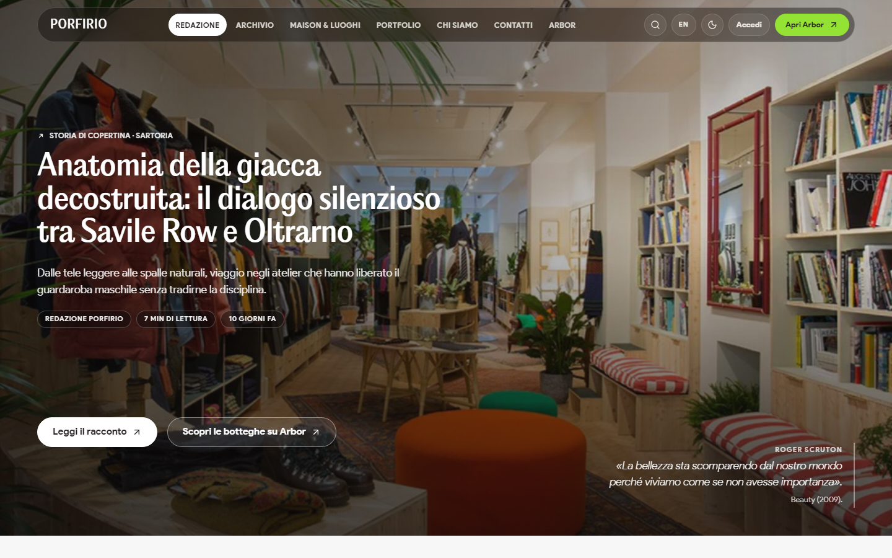
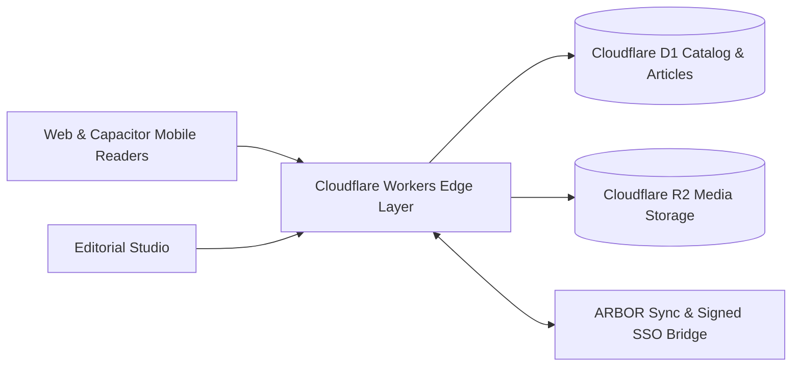
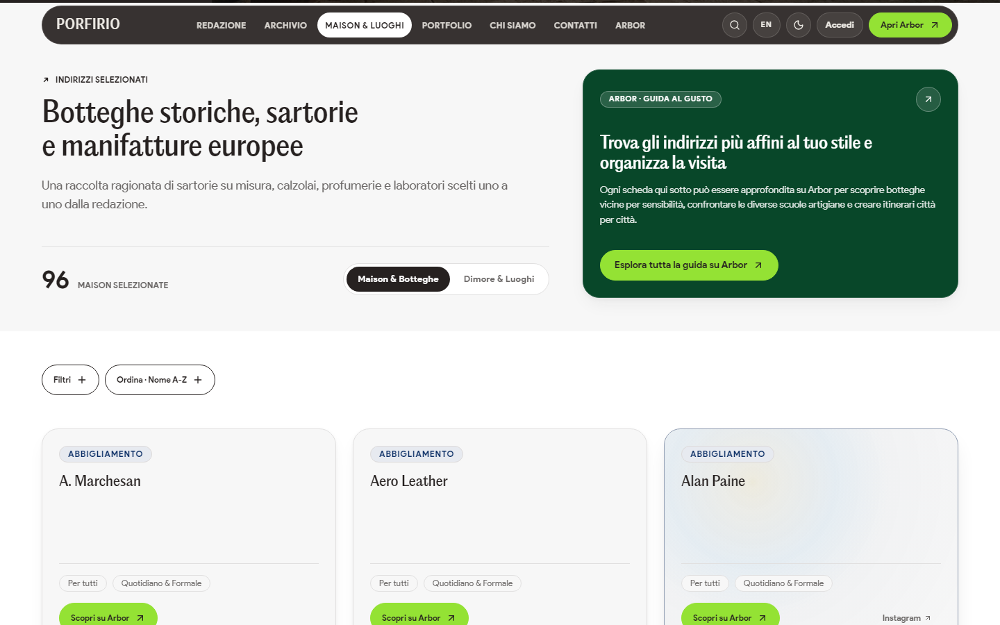
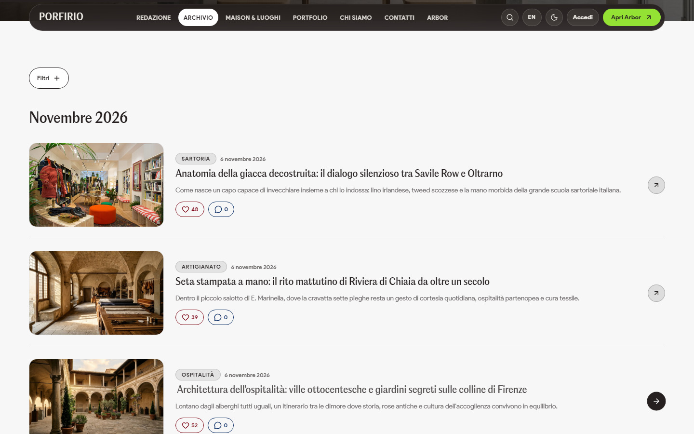
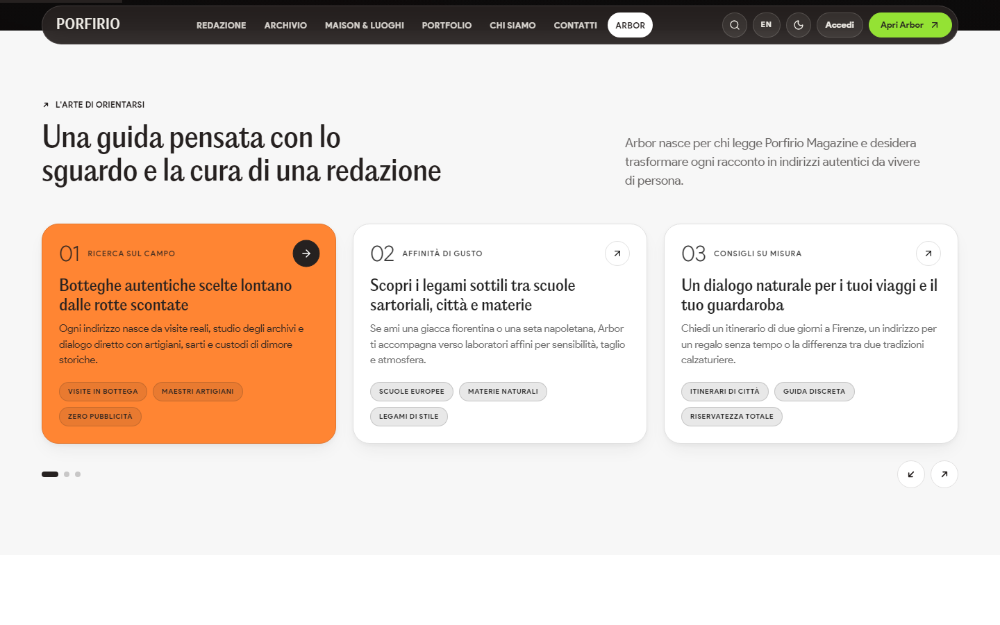

# Porfirio Magazine

> **Bilingual digital editorial platform and curated directory of 270 sartorial ateliers and cultural venues, delivered on a low-latency edge architecture synchronized with ARBOR.**



**Category:** Digital Publishing & Edge Media Platform | **Core Stack:** React, Python, Cloudflare Workers, D1, R2, Capacitor | **Live Platform:** [porfiriomagazine.it](https://porfiriomagazine.it) | **Navigation:** [Back to Portfolio](../README.md)

---

## Project Overview

Porfirio Magazine is a full-stack bilingual (Italian and English) digital publication dedicated to classic tailoring, craftsmanship, and European cultural venues. It combines long-form editorial publishing, an interactive 270-entity international directory, automated social-card generation, and mobile apps into a unified product.

- **Main purpose:** Unify bilingual editorial publishing, curated directory browsing, and cross-platform distribution under one editorial workflow.
- **Primary use case:** Publishing long-form stories in Italian and English while connecting readers directly to verified ateliers and venues in [ARBOR](../arbor/README.md).
- **Source code policy:** This folder is a public technical showcase. The production source code remains private.

---

## Objectives

Independent digital magazines often stitch together separate CMS plugins, translation tools, map widgets, and social-media templates, causing inconsistent branding and slow page loads.

- **Unified bilingual publishing:** Manage authoring, scheduled releases, SEO sitemaps, RSS feeds, and hash-cached literary translations from one workspace.
- **Editorial-to-discovery continuity:** Keep the magazine's 270-entry directory synchronized 1:1 with the ARBOR discovery platform and allow single-click reader transitions.
- **Global edge performance:** Serve articles, responsive imagery, and directory queries directly from edge nodes with immutable asset caching.

---

## Key Features

- **Bilingual Editorial Engine (IT / EN):** Rich-text authoring, reading-time estimation, scheduled publishing, and nuance-preserving literary translation cached by content hash.
- **Curated Directory & Interactive 3D Globe:** Searchable catalog of 96 heritage brands and 174 cultural venues across tailoring, footwear, fragrance, and hospitality with interactive map exploration.
- **1:1 Master Catalog Synchronization:** Bidirectional sync keeping editorial venue profiles aligned across relational storage, edge databases, and ARBOR.
- **Single-Use Cross-Platform SSO:** Cryptographically signed, replay-protected handoff tokens transitioning signed-in readers from an article into the ARBOR concierge.
- **Mobile Packaging & Automated Social Assets:** Capacitor iOS/Android builds with signed over-the-air bundle updates, plus automated multi-ratio social carousel rendering.

---

## Development Approach

Porfirio Magazine is engineered for editorial longevity and predictable latency: static and media-heavy reader paths execute at the network edge, while authoring and translation workflows enforce strict quality gates.

- **Content-addressed translation caching:** Translated articles are keyed by the `SHA-256` digest of the canonical source body so unchanged paragraphs are never re-translated unnecessarily.
- **Fail-clean editorial assistance:** Editorial drafting and translation endpoints return an explicit temporary-unavailable status under load rather than silently degrading to lower-quality fallback text.
- **Deterministic media hierarchy:** Uploaded photography is stored under entity-scoped paths in object storage with immutable cache headers and manifest tracking.

---

## Architecture Overview

Reader traffic is served at the edge through Cloudflare Workers backed by D1 relational tables and R2 media storage, paired with editorial authoring services, ARBOR catalog synchronization, and Capacitor mobile clients.



- **Reader & Mobile Layer:** Responsive React frontend with Light/Dark themes, interactive directory filters, 3D globe navigation, and Capacitor mobile shells.
- **Edge Application Layer:** Cloudflare Workers handling routing, SEO metadata, RSS/sitemap generation, translation caching, and replay-safe SSO assertions.
- **Storage Layer:** Cloudflare D1 for structured editorial and directory records paired with R2 object storage for high-resolution photography and OTA bundles.

---

## Screenshots & Demonstrations

| Cover Story & Editorial Home | Curated Maisons & Venues Directory |
| :--- | :--- |
| <br><sub>Full-bleed cover story layout with reading-time badges, bilingual toggle, and direct entry into the ARBOR guide.</sub> | <br><sub>Filterable international directory organizing 96 Maisons and 174 cultural venues across European craft capitals.</sub> |

| Chronological & Category Archive | Editorial Bridge to ARBOR |
| :--- | :--- |
| <br><sub>Structured monthly archive displaying category tags, reader engagement counters, and concise editorial excerpts.</sub> | <br><sub>Integrated editorial section connecting magazine stories to personalized atelier itineraries inside ARBOR.</sub> |

---

## Code Samples

The generic snippet below illustrates content-addressed cache key derivation using `SHA-256`, ensuring cached translations invalidate automatically whenever an editor updates the source article:

```javascript
import crypto from "node:crypto";

export function buildTranslationCacheKey(articleId, targetLang, markdownBody) {
  const normalized = markdownBody.trim().replace(/\r\n/g, "\n");
  const contentHash = crypto
    .createHash("sha256")
    .update(normalized, "utf8")
    .digest("hex")
    .slice(0, 16);

  return `translation:${articleId}:${targetLang}:${contentHash}`;
}
```

---

## Results

- **What was achieved:** A live bilingual digital magazine and 270-entity international directory operating at the edge and tightly integrated with the ARBOR discovery ecosystem.
- **Practical value:** Gives a small editorial team publication-grade typography, instant bilingual reach, and unified catalog management without third-party CMS bloat.
