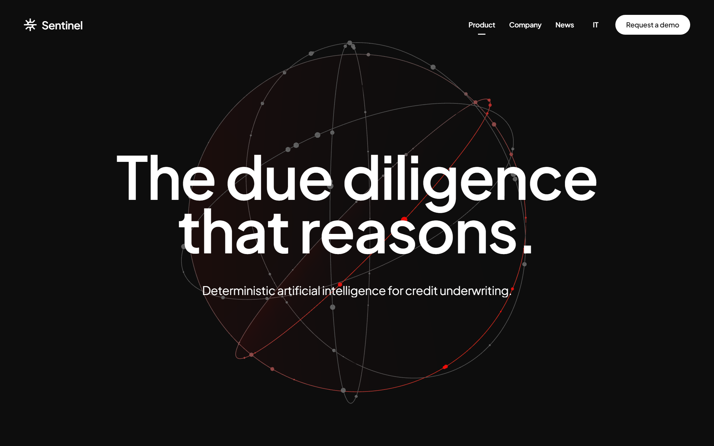
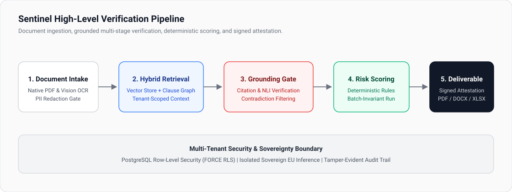
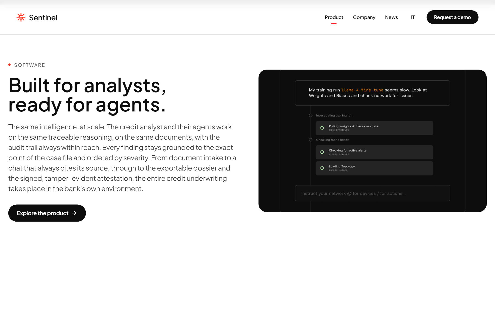
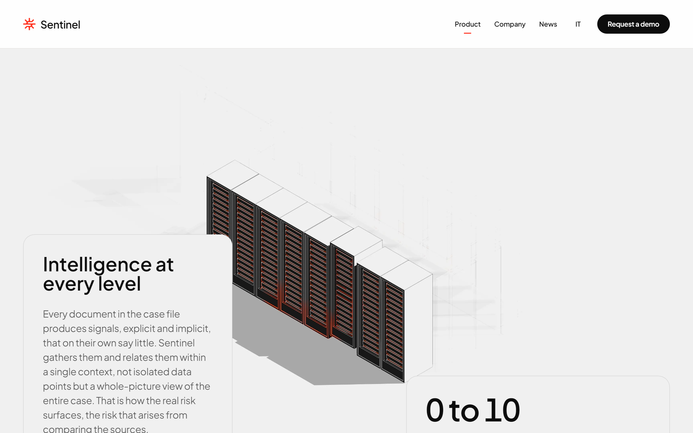
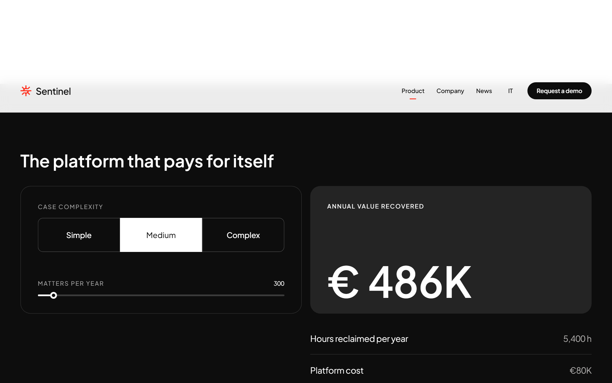

# Sentinel

> **Multi-tenant document intelligence platform for credit, legal, and M&A teams that extracts, verifies, scores, and cryptographically attests risk across due-diligence case files.**



**Category:** Enterprise Document Intelligence & Risk SaaS | **Core Stack:** Python, FastAPI, PostgreSQL, Neo4j, Vector Search, Self-Hosted vLLM | **Navigation:** [Back to Portfolio](../README.md)

---

## Project Overview

Sentinel automates complex financial and legal document review for regulated credit underwriting and due diligence. Rather than generating free-form summaries, it produces structured risk findings backed by exact source citations, deterministic scoring rules, and a signed attestation record.

- **Main purpose:** Deliver reproducible, audit-ready due-diligence analysis inside sovereign or on-premise environments.
- **Primary use case:** Reviewing multi-document credit files, contracts, comfort letters, and corporate disclosures in English and Italian.
- **Source code policy:** This folder is a public technical showcase. The production source code remains private.

---

## Objectives

In regulated finance and legal review, unverified generative summaries create compliance risk because findings can shift across runs or cite clauses inaccurately.

- **Zero ungrounded claims:** Require every extracted finding to pass automated citation, coverage, and contradiction checks before acceptance.
- **Run-to-run reproducibility:** Guarantee consistent outputs for identical case inputs even under multi-tenant operation.
- **Sovereign data control:** Keep sensitive financial dossiers within tenant-isolated storage and self-hosted European open-weight inference stacks.

---

## Key Features

- **Multi-Stage Grounding Gate:** Validates candidate findings against source pages using exact span matching, natural-language inference contradiction checks, and rule validation.
- **Cross-Document Clause Graph:** Links definitions, obligations, and financial figures across separate files in a case dossier to surface hidden inconsistencies.
- **Deterministic Risk Scoring:** Applies versioned domain playbooks and explicit severity rules so final risk ratings remain transparent and auditable.
- **Cryptographic Analysis Attestation:** Emits a signed attestation token per completed review, binding input hashes, rule versions, and accepted findings.
- **Audit-Ready Deliverables:** Exports structured committee dossiers in PDF, DOCX, PPTX, and XLSX formats alongside interactive cited Q&A.

---

## Development Approach

Sentinel treats language models as untrusted proposers surrounded by deterministic verifiers. Extraction, verification, and scoring are decoupled so no model can directly alter a risk score or bypass citation gates.

- **Batch-invariant execution:** Inference workers serialize evaluation batches and fix decoding parameters so concurrent tenant jobs cannot alter token probabilities.
- **Defense-in-depth multi-tenancy:** Tenant separation is enforced at the database engine level with PostgreSQL `FORCE ROW LEVEL SECURITY` alongside isolated vector namespaces.
- **Continuous golden-set evaluation:** Extraction accuracy, false-positive rates, and latency overhead are gated automatically against curated benchmark suites.

---

## Architecture Overview

Documents pass through OCR and PII redaction into hybrid vector and graph stores. Specialized analysis stages propose findings, a grounding gate filters unsupported claims, and the scoring engine produces attested deliverables.



- **Ingestion & Retrieval Layer:** Native PDF/Vision-OCR parsing, PII filtering, vector indexing, and cross-reference graph construction.
- **Verification & Scoring Layer:** Multi-step grounding checks, contradiction detection, and rule-based playbook evaluation.
- **Security & Control Plane:** Separate tenant provisioning service, PostgreSQL row-level security, and cryptographic run attestation.

---

## Screenshots & Demonstrations

| Traceable Analyst Workspace | Cross-Document Signal Synthesis |
| :--- | :--- |
| <br><sub>Product overview highlighting severity-ordered findings, source-cited reasoning, and in-environment deployment for credit teams.</sub> | <br><sub>Illustration of whole-case context linking explicit and implicit risk signals across an entire underwriting file.</sub> |

| Operational Value & Throughput Simulator |
| :--- |
| <br><sub>Interactive workload estimator modeling analyst hours reclaimed across varying annual case volumes and complexity tiers.</sub> |

---

## Code Samples

The generic example below illustrates a monotonic-clock circuit breaker pattern used to isolate external or model-serving dependencies so a degraded downstream service fails fast and triggers deterministic fallbacks:

```python
import time
from dataclasses import dataclass


@dataclass
class CircuitBreaker:
    failure_threshold: int = 3
    recovery_seconds: float = 30.0
    failures: int = 0
    opened_at: float | None = None

    def allow_request(self) -> bool:
        if self.opened_at is None:
            return True
        if (time.monotonic() - self.opened_at) >= self.recovery_seconds:
            return True  # Half-open probe
        return False

    def record_success(self) -> None:
        self.failures = 0
        self.opened_at = None

    def record_failure(self) -> None:
        self.failures += 1
        if self.failures >= self.failure_threshold:
            self.opened_at = time.monotonic()
```

---

## Results

- **What was achieved:** A complete multi-tenant due-diligence platform combining sovereign model serving, hybrid graph retrieval, multi-stage grounding verification, cryptographic attestation, and a companion web showcase.
- **Practical value:** Compresses multi-week manual document cross-checking into hours while preserving the traceability and determinism required by credit committees and auditors.
