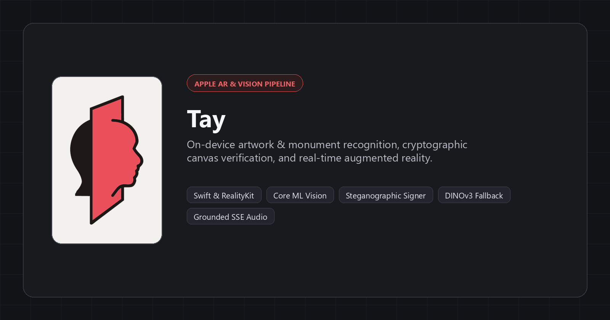
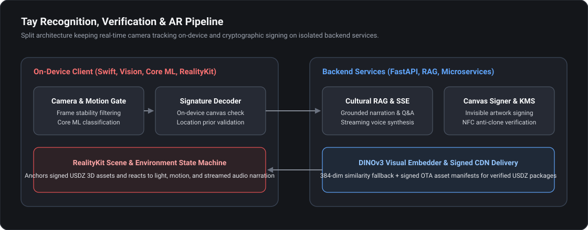

# Tay

> **Native Apple augmented-reality platform and backend verification pipeline that recognizes physical artworks and monuments through the camera, verifies canvas authenticity, and streams grounded audio narration.**



**Category:** Native Apple AR, Computer Vision & Cloud Microservices | **Core Stack:** Swift, RealityKit, Vision / Core ML, Python, FastAPI, PostgreSQL, DINOv3 | **Navigation:** [Back to Portfolio](../README.md)

---

## Project Overview

Tay is a multi-service augmented-reality and visual recognition system built for Apple platforms (iPhone, iPad, Apple Vision Pro, Apple Watch, and macOS). Pointing the camera at a monument or a signed physical artwork identifies the subject on-device, verifies its authenticity, anchors interactive 3D scenes in real space, and streams grounded narration and voice answers.

- **Main purpose:** Bridge physical cultural sites and printed artworks with responsive, authenticated augmented-reality experiences and narration.
- **Primary use case:** Museum and monument cultural guidance, historical site overlays, and authenticated physical canvases that unlock interactive AR characters.
- **Source code policy:** This folder is a public technical showcase of an active private multi-repository ecosystem. Production source code and trained weights remain private.

---

## Objectives

Mobile AR cultural guides typically suffer from jittery camera recognition, unverified LLM narration that invents historical facts, or bulky API processes bogged down by heavy vision models.

- **Instant on-device recognition:** Gate camera frames by motion stability and run Core ML classification directly on Apple silicon before making network calls.
- **Tamper-resistant physical canvases:** Ensure printed artworks can be cryptographically signed before print and verified reliably after real-world camera scanning.
- **Clean service boundaries:** Isolate GPU-heavy image signing and visual-embedding workloads from the core streaming API so narration and Q&A stay responsive.

---

## Key Features

- **Motion-Gated On-Device Vision:** Combines camera frame stability checks, local Core ML classification, result caching, and location priors for fast, low-power object matching.
- **Invisible Canvas Signing & Pre-Print Suitability:** Embeds recoverable steganographic signatures attested by KMS keys into artwork images, paired with an offline suitability scorer that tests print-and-scan survival before production.
- **DINOv3 Visual-Similarity Fallback:** Dedicated internal microservice generating 384-dimensional Vision Transformer (`ViT-S/16`) embeddings for K-nearest-neighbor fallback matching.
- **Grounded SSE Narration & Q&A:** Streams bilingual (IT/EN) cultural narration, cited free-text Q&A, and synthesized voice audio grounded in a curated cultural corpus.
- **Environment-Reactive AR Scenes:** Validates and signs `USDZ` 3D assets and state machines that react to ambient light, device motion, speech, and user gestures in RealityKit.

---

## Development Approach

Tay splits latency-critical perception from trust-critical verification: frame tracking and initial decoding run on the user's device, while cryptographic signing, NFC anti-clone checks, and corpus-grounded narration run on hardened backend services.

- **Protocol-isolated heavy inference:** Image signing and DINOv3 embedding run in separate internal HTTP services behind constant-time bearer authentication, decompression-bomb guards, and bounded concurrency semaphores.
- **Signed OTA asset chain:** Over-the-air ML models and `USDZ` 3D packages are served through signed manifests so the client rejects tampered CDN payloads.
- **Fail-fast production configuration:** Services refuse to boot in production if placeholder tokens or unconfigured cryptographic trust roots are detected.

---

## Architecture Overview

The native Swift client handles camera stability gating, Core ML inference, and RealityKit rendering, communicating over HTTPS/SSE with the FastAPI orchestrator and two isolated internal vision microservices.



- **Native Apple Client:** Swift modular targets covering Vision/Core ML frame recognition, RealityKit 3D anchoring, background asset pre-downloading, and audio playback.
- **Core Backend API:** FastAPI orchestrator managing Apple Sign-In, cost-weighted Redis rate limiting, grounded RAG narration over SSE, `USDZ` validation, and NFC anti-clone verification.
- **Internal Vision Microservices:** Dedicated steganographic canvas signer (with KMS attestation and pre-print lab reports) and DINOv3 384-float embedding service.

---

## Screenshots & Demonstrations

| End-to-End Recognition & Signing Architecture |
| :--- |
| <br><sub>High-level split between on-device Swift/Core ML perception and backend RAG, steganographic signing, and DINOv3 fallback microservices.</sub> |

*(Additional on-device AR capture previews will be added as the iOS and visionOS scene packages reach public release.)*

---

## Code Samples

The generic Swift snippet below illustrates motion-stability gating on incoming camera readings, preventing expensive Core ML vision inference from firing while the user is actively panning the device:

```swift
import simd

public struct MotionStabilityGate {
    public let maxAngularVelocity: Double
    public let requiredStableFrames: Int
    private var consecutiveStableFrames: Int = 0

    public init(maxAngularVelocity: Double = 0.18, requiredStableFrames: Int = 4) {
        self.maxAngularVelocity = maxAngularVelocity
        self.requiredStableFrames = requiredStableFrames
    }

    public mutating func shouldRunInference(rotationRate: SIMD3<Double>) -> Bool {
        let magnitude = simd_length(rotationRate)
        if magnitude <= maxAngularVelocity {
            consecutiveStableFrames += 1
        } else {
            consecutiveStableFrames = 0
        }
        return consecutiveStableFrames >= requiredStableFrames
    }
}
```

---

## Results

- **What was achieved:** A cohesive multi-repository Apple AR and computer-vision stack spanning native Swift targets, a streaming RAG backend, an invisible canvas-signing service with pre-print diagnostics, and a DINOv3 embedding microservice.
- **Practical value:** Establishes a reusable technical foundation for authenticated physical-to-digital art experiences and low-latency cultural guides without coupling mobile responsiveness to server-side GPU load.
