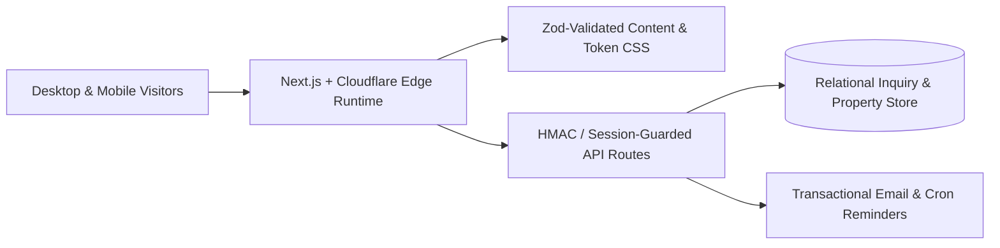
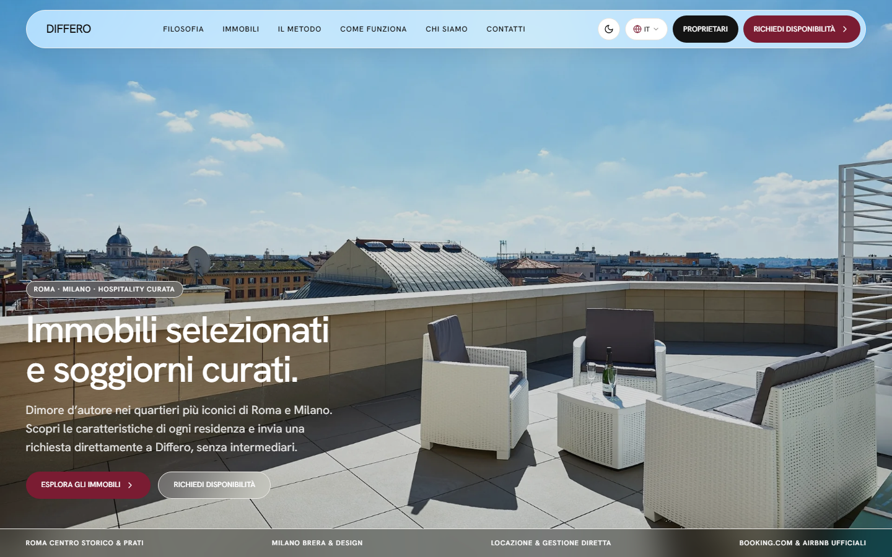
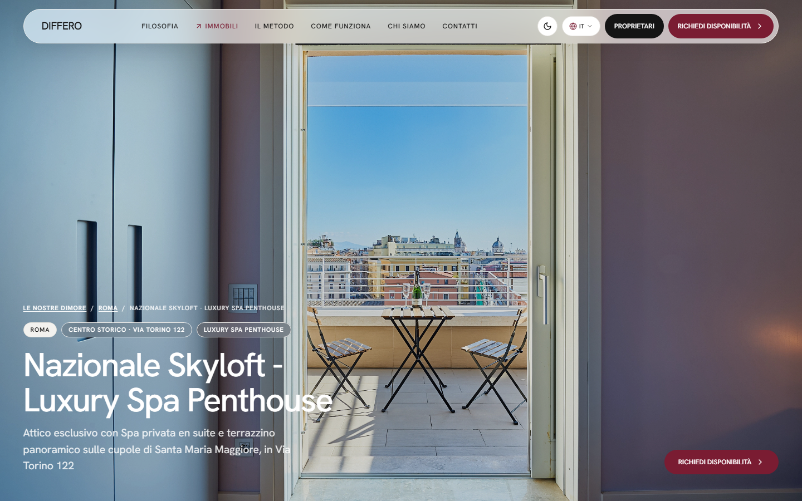
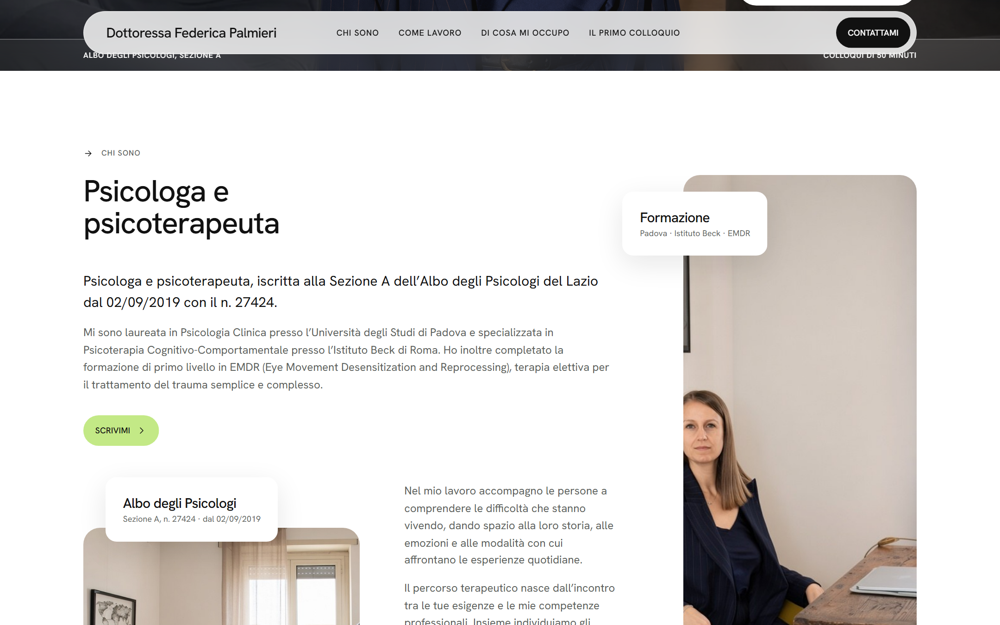

# Client Web Platforms (Differo & Dott.ssa Federica Palmieri)

> **Two production client web platforms engineered on strict CSS design-token systems, Next.js edge runtimes, and domain-specific compliance and booking workflows.**


**Category:** Bespoke Client Web Engineering | **Core Stack:** Next.js, React, TypeScript, CSS Modules & Design Tokens, Zod, Cloudflare Workers / OpenNext | **Live Reference:** [federicapalmieridoc.it](https://www.federicapalmieridoc.it) | **Navigation:** [Back to Portfolio](../README.md)

---

## Project Overview

This showcase groups two custom production web platforms built for distinct regulated and high-touch service domains:

1. **Differo s.r.l. (*Immersive Hospitality*):** Direct-inquiry and portfolio platform presenting curated residences in Rome and Milan, designed to connect guests and property owners directly without marketplace intermediaries.
2. **Dott.ssa Federica Palmieri (*Clinical Psychology*):** Professional healthcare web platform ([federicapalmieridoc.it](https://www.federicapalmieridoc.it)) built for clinical sobriety, WCAG 2.2 AA accessibility, and full compliance with Italian psychology ethics and healthcare advertising guidelines (CNOP).

- **Main purpose:** Deliver fast, maintainable, brand-specific web platforms with zero third-party tracking bloat.
- **Primary use case:** Direct hospitality availability management (Differo) and accessible, privacy-first clinical intake (Dott.ssa Federica Palmieri).
- **Source code policy:** This folder is a public technical showcase. Client repositories and operational configurations remain private.

---

## Objectives

Off-the-shelf page builders introduce heavy client bundles, third-party trackers, inconsistent mobile typography, and fragile form handling that poorly serve boutique hospitality and regulated healthcare practices.

- **Automated design-system discipline:** Enforce color contrast, spacing, and fluid typography from a single CSS token contract verified automatically in unit tests.
- **Structured operational workflows:** Support multi-stage availability review and transactional emails for hospitality, and build-time schema validation plus anti-abuse contact protection for healthcare.
- **Privacy and accessibility by default:** Eliminate third-party ad/analytics cookies, enforce strict per-request Content Security Policies, and meet WCAG 2.2 AA contrast and keyboard standards.

---

## Key Features

- **Differo - 5-Stage Direct Inquiry & Admin Backoffice:** Guides guests from date/capacity validation through protected backoffice review (`Pending`, `Confirmed`, `Unavailable`) and automated transactional emails linking verified booking channels or alternative residences.
- **Differo - Multi-City Portfolio & 12-Language UI:** Filterable property catalog across Rome and Milan with architectural spec sheets, native Light/Dark themes, and instant client-side switching across 12 languages.
- **Palmieri - CNOP & WCAG 2.2 AA Clinical Design:** Calibrated high-contrast editorial palette (`>= 4.5:1`), structured professional registration disclosures, and accessible WAI-ARIA mobile navigation.
- **Palmieri - Build-Time Zod Content Gate & Hardened Security:** Validates all clinical copy, SEO metadata, and legal notices before production builds, paired with per-request cryptographic CSP nonces and `HMAC-SHA256` signed contact forms.
- **Shared Mobile Touch-Hold Contrast UX:** Smoothly dims background photography during touch-hold or scroll gestures on smartphones to keep overlaid typography legible.

---

## Development Approach

Both projects share a disciplined frontend architecture: zero external UI component libraries, strict CSS Modules bound to verified design tokens, and edge-ready server routes with minimal runtime dependencies.

- **Test-enforced design tokens:** Automated Vitest suites parse stylesheets to prevent hardcoded hex values or off-scale spacing from entering production.
- **Defense-in-depth form & session security:** Admin sessions use `scrypt` password hashing and `httpOnly` cookies, uploaded property images validate file magic bytes, and public contact forms combine honeypots, IP rate limiting, and signed timestamps.
- **Structured SEO & Edge Operations:** Programmatic Schema.org JSON-LD (`MedicalBusiness` / hospitality metadata), OpenGraph generation, and scheduled Cloudflare Worker maintenance reminders.

---

## Architecture Overview

Both platforms run on Next.js App Router deployed to edge infrastructure via OpenNext for Cloudflare, pairing prerendered editorial routes with lightweight server endpoints for inquiries, admin review, and transactional email dispatch.



- **Presentation Layer:** Semantic HTML, fluid typography, Light/Dark token themes, and Playwright + Axe end-to-end accessibility verification.
- **Application Layer:** Middleware CSP nonce injection, inquiry state machine, property management backoffice, and build-time content validators.
- **Persistence & Delivery Layer:** Edge-compatible relational storage, magic-byte-verified WebP media assets, and transactional email delivery.

---

## Screenshots & Demonstrations

| Differo: Curated Hospitality Hero | Differo: Residence Detail (`Nazionale Skyloft`) |
| :--- | :--- |
| <br><sub>Full-bleed opening showcasing Rome and Milan residences, language selector, Dark Mode toggle, and direct availability CTA.</sub> | <br><sub>Dedicated residence view combining architectural metadata, photo gallery, and pre-linked availability request workflow.</sub> |

| Dott.ssa Federica Palmieri: Clinical Positioning | Dott.ssa Federica Palmieri: Credentials & Method |
| :--- | :--- |
| <br><sub>High-contrast editorial opening presenting clinical qualifications, Rome and online practice modes, and first-consultation access.</sub> | <br><sub>Asymmetric three-column biography highlighting official Order registration, clinical specialization, and therapeutic approach.</sub> |

---

## Code Samples

The generic TypeScript snippet below illustrates `HMAC-SHA256` timestamp signing and expiration checking used to reject forged or replayed form submissions without relying on third-party CAPTCHA trackers:

```typescript
import { createHmac, timingSafeEqual } from "node:crypto";

export function verifyFormTimestampToken(
  issuedAtMs: number,
  signatureHex: string,
  secret: string,
  minFillMs = 2_500,
  maxAgeMs = 3_600_000
): boolean {
  const age = Date.now() - issuedAtMs;
  if (age < minFillMs || age > maxAgeMs) return false;

  const expected = createHmac("sha256", secret).update(String(issuedAtMs)).digest();
  const provided = Buffer.from(signatureHex, "hex");
  return expected.length === provided.length && timingSafeEqual(expected, provided);
}
```

---

## Results

- **What was achieved:** Two bespoke, edge-deployed client web platforms tailored respectively to luxury direct-booking hospitality and regulated clinical psychology.
- **Practical value:** Replaces generic templates and intermediary lock-in with fast, accessible, tracker-free digital platforms tailored to each client's exact operational workflow.
